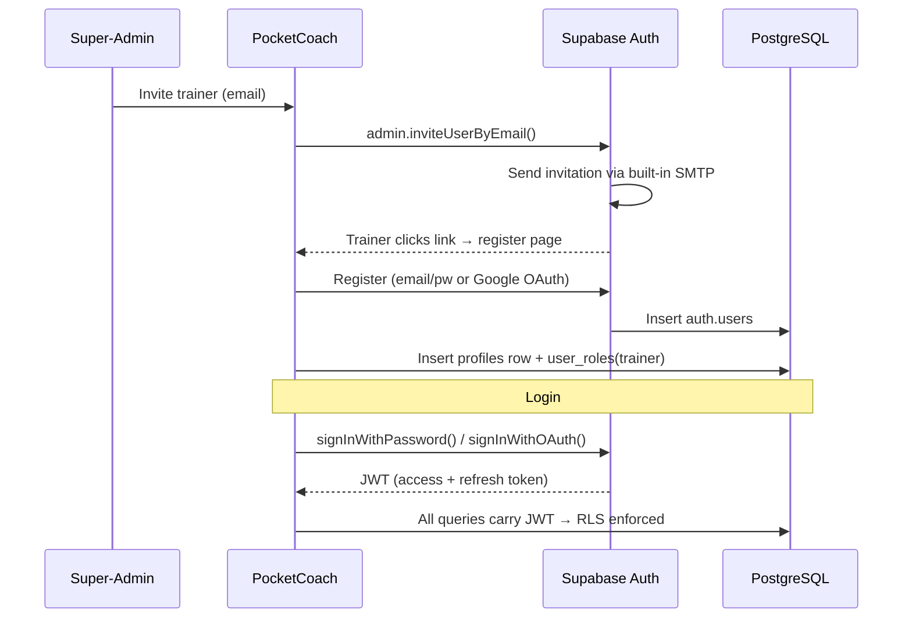

# Authentication & Onboarding

**Summary**: Describes the authentication methods, user invitation flow, and onboarding sequence for PocketCoach, including the Supabase Auth integration and JWT-based RLS enforcement.

**Sources**: None

**Last updated**: 2026-10-11

---

## Table of Contents
- [Authentication Methods](#authentication-methods)
- [Invitation & Registration Flow](#invitation--registration-flow)
- [Current Implementation (Sub-Phases 1.2–1.4)](#current-implementation-sub-phases-1214)
- [Access Rules for Registration & Profiles](#access-rules-for-registration--profiles)
- [Calendar Integration](#calendar-integration)

---

## Authentication Methods

| Method | Status |
|---|---|
| Email + Password | ✅ Phase 1 |
| Google Sign-In (OAuth) | ✅ Phase 1 |
| Apple Sign-In (OAuth) | ⏳ Deferred — requires $99/year Apple Developer membership |

Supabase Auth handles all authentication flows natively, issuing JWTs (access + refresh tokens) on successful login. All subsequent database queries carry the JWT, and Row-Level Security (RLS) policies enforce permissions server-side. See [[codebase/architecture/database-schema]] for the full RLS policy matrix.

---

## Invitation & Registration Flow

New trainers are invited by a Super-admin. Invitation emails are sent using Supabase Auth's built-in SMTP — no external email provider is needed in Phase 1.

The diagram below is the **target design**. The current implementation differs; see [Current Implementation](#current-implementation-sub-phases-1214).

### Post-Registration

- The base **Trainer** role is automatically granted upon registration.
- The Super-admin can additionally assign **Head-trainer** and/or **Super-admin** roles at any time.
- Trainers can update their display name, profile picture, preferred language, and a free-text "Responsibility / Speciality" field.

---

## Current Implementation (Sub-Phases 1.2–1.4)

The invite flow built so far is a development-grade version of the target design above.

**Sending an invite** (`InviteModal`, Super-admin only):
1. The account is created with `signUp` on a **separate, in-memory auth client** (`createIsolatedAuthClient()`), so the admin's own session is never replaced by the invitee's. Earlier versions used the shared client, which logged the admin in as the invited user.
2. The profile (display name, specialty, 14/18 Coach label) and the chosen base role are written **as the admin**, so invited Head-trainers and Super-admins receive their role. A failure in either write is shown to the admin.
3. A password-reset email is sent whose link points at `/invite/<base64(email)>`.

**Completing registration** (`/invite/:token`, `InvitePage`): the invitee signs in with the temporary password, replaces it with their own password, and sets their display name. If no account exists yet, the page signs the user up and creates a profile with the base `trainer` role.

**Known limitations** (tracked in [[codebase/known-issues]]):
- Invited accounts are created with a **fixed temporary password** (`Password123!`, acceptable for local development only). Until the invitee completes setup, anyone who knows their email can sign in as them.
- The invite link is only `base64(email)`: it carries no secret and is not single-use.
- Self-registration at `/register` is open (`enable_signup = true`), so anyone can create a Trainer account and read the schedule.
- Email confirmation is off locally. With confirmation on, `signUp` returns no session, so the follow-up profile and role writes would be rejected by RLS. A database trigger on `auth.users` that creates the profile and `trainer` role is the planned fix.
- The target design (`admin.inviteUserByEmail()` from an Edge Function with a single-use token) resolves all of the above and replaces the temporary-password approach.

---

## Access Rules for Registration & Profiles

These rules are enforced in the database (see [[codebase/architecture/database-schema#row-level-security]]):

| Action | Who | Condition |
|---|---|---|
| Create own profile | Any authenticated user | Plain profile only: not a 14/18 Coach, active, and `email` equals their login email (case-insensitive) |
| Create any profile | Super-admin | — |
| Grant roles | Super-admin | Any role |
| Self-grant a role | Any authenticated user | Only the base `trainer` role, for themselves |
| Change `email`, `is_active`, 14/18 Coach label | Super-admin only | Enforced by the `protect_profile_admin_fields` trigger |
| Edit display name, avatar, specialty, language, calendar token | The profile's owner | — |

Logged-out callers (including anyone holding the public anon key) can neither read nor write profiles or roles. An earlier policy fallback that let anonymous callers insert profiles and roles during invite setup allowed anyone to grant themselves `super_admin`; it was removed in migration `20261011000003`.

The **14/18 Coach label** is managed by Super-admins only: it is set when inviting a trainer and can be changed later in the **Role Manager** modal on the trainer roster. It is read-only on a trainer's own settings page.

---

## Calendar Integration

Trainers can export their assigned sessions to personal calendars. The feature is opt-in and requires explicit user consent.

| Method | Mechanism | Details |
|---|---|---|
| **Static download** | Client-side `ics` library | `.ics` from cached session data. Works offline. |
| **Live subscription** | `GET /functions/v1/calendar-feed?token=<calendar_token>` | Edge Function queries assignments, returns `text/calendar`. Token stored in `profiles.calendar_token`. |

Exported events include: date, time, session location (if available), and co-trainers. Training theme field is omitted until Phase 2.

> **Implementation status:** the Settings page already shows the subscription URL and the "Regenerate Link" action, but the URL is built from the web app's origin rather than the Supabase functions URL, and the `calendar-feed` Edge Function does not exist yet. The feed is delivered in Sub-Phase 1.6.

### Token Security & Revocation

To protect calendar privacy, trainers can regenerate their calendar token at any time in **Profile Settings** via a **"Regenerate Link"** button. Generating a new token immediately invalidates the old URL parameter, disconnecting any previously connected external calendars.

## Related pages

- [[codebase/architecture/system-architecture]]
- [[codebase/architecture/database-schema]]
- [[codebase/data-privacy-gdpr]]
- [[codebase/known-issues]]
- [[codebase/risk-analysis]]
- [[requirements/overview-roles-auth]]
