# Database Schema

**Summary**: PostgreSQL database schema for PocketCoach Phase 1 covering 16 tables, the ER diagram, column definitions, the enforced Row-Level Security policies, database functions, triggers and constraints, the migration history, and Phase 2 extension points for deferred tables.

**Sources**: None

**Last updated**: 2026-10-11

---

## Table of Contents
- [ER Diagram](#er-diagram)
- [Phase 2 Extension Points](#phase-2-extension-points)
- [Row-Level Security](#row-level-security)
- [Functions, Triggers & Constraints](#functions-triggers--constraints)
- [Migration History](#migration-history)

---

## ER Diagram

The schema covers 16 tables. Phase 2 tables (`training_blocks`, `block_weeks`, `global_themes`, `season_themes`, `training_plan_notes`, `post_session_comments`) are documented as extension points below.

```mermaid
erDiagram
    PROFILES {
        uuid id PK "= auth.users.id"
        text display_name
        text email
        text avatar_url
        text specialty "free-text responsibility field"
        boolean is_junior_coach "14/18 Coach label"
        boolean is_active
        text preferred_language "en | de"
        text calendar_token "opaque token for iCal feed"
        timestamptz created_at
        timestamptz updated_at
    }

    USER_ROLES {
        uuid id PK
        uuid profile_id FK
        text role "trainer | head_trainer | super_admin"
        timestamptz granted_at
        uuid granted_by FK
    }

    DEVICE_TOKENS {
        uuid id PK
        uuid profile_id FK
        text token "FCM push token"
        text platform "web | android | ios"
        timestamptz created_at
        timestamptz updated_at
    }

    LOCATIONS {
        uuid id PK
        text name "Sporthalle Schulhaus Apfelbaum, etc."
        text district_area "Oerlikon, Friesenberg, Zürich-Affoltern"
        text address "street, postcode, city (entered by the club)"
        text trainer_note "entrance, parking, key"
        boolean is_active
        timestamptz created_at
    }

    SEASON_TEMPLATES {
        uuid id PK
        text name "Standard Junior Season"
        text description
        boolean is_default
        jsonb template_data "JSON spec of training days, times, locations, and groups"
        timestamptz created_at
    }

    SEASONS {
        uuid id PK
        text name
        date start_date
        date end_date
        boolean is_active
        timestamptz created_at
    }

    TRAINING_DAYS {
        uuid id PK
        uuid season_id FK
        uuid location_id FK
        smallint day_of_week "0=Sun .. 6=Sat"
        time default_start_time
        time default_end_time
        smallint required_regular "0-3, trainers needed"
        smallint required_junior "0-2, 14/18 coaches needed"
    }

    TRAINING_DAY_PLAYER_GROUPS {
        uuid id PK
        uuid training_day_id FK
        uuid player_group_id FK
    }

    PLAYER_GROUPS {
        uuid id PK
        uuid season_id FK
        text name "Kids/Basic, Advanced-1, Advanced-2"
        text description
        smallint sort_order
    }

    SESSIONS {
        uuid id PK
        uuid season_id FK
        uuid location_id FK
        uuid block_week_id FK "nullable — Phase 2 extension"
        date session_date
        smallint day_of_week
        time start_time
        time end_time
        boolean is_time_overridden
        smallint required_regular "copied from the training day"
        smallint required_junior "copied from the training day"
        timestamptz published_at "null = draft, visible to Head-trainer+ only"
        timestamptz created_at
    }

    SESSION_PLAYER_GROUPS {
        uuid id PK
        uuid session_id FK
        uuid player_group_id FK
    }

    SESSION_ASSIGNMENTS {
        uuid id PK
        uuid session_id FK
        uuid profile_id FK "nullable — anonymized on deletion"
        text track "regular | junior_coach"
        text session_role "primary | assistant_coach"
        text status "active | absent_pending_sub | replaced"
        boolean is_substitute
        timestamptz assigned_at
        uuid assigned_by FK
    }

    AVAILABILITY_SURVEYS {
        uuid id PK
        uuid season_id FK
        text name
        date range_start
        date range_end
        text status "draft | open | closed"
        timestamptz created_at
    }

    AVAILABILITY_RESPONSES {
        uuid id PK
        uuid survey_id FK
        uuid profile_id FK
        uuid session_id FK
        text state "available | unavailable | tentative"
        timestamptz responded_at
    }

    SUBSTITUTION_REQUESTS {
        uuid id PK
        uuid session_id FK
        uuid original_trainer_id FK
        uuid volunteer_id FK "nullable"
        text track "regular | junior_coach"
        text status "open | filled | escalated"
        timestamptz created_at
        timestamptz filled_at
        timestamptz escalated_at
    }

    NOTIFICATIONS {
        uuid id PK
        uuid recipient_id FK
        text event_type
        jsonb payload
        boolean is_read
        timestamptz created_at
    }

    PROFILES ||--o{ USER_ROLES : "has roles"
    PROFILES ||--o{ DEVICE_TOKENS : "registers"
    PROFILES ||--o{ SESSION_ASSIGNMENTS : "assigned to"
    PROFILES ||--o{ AVAILABILITY_RESPONSES : "responds"
    PROFILES ||--o{ NOTIFICATIONS : "receives"

    SEASONS ||--o{ TRAINING_DAYS : "has days"
    SEASONS ||--o{ SESSIONS : "generates"
    SEASONS ||--o{ AVAILABILITY_SURVEYS : "runs"
    SEASONS ||--o{ PLAYER_GROUPS : "defines"

    TRAINING_DAYS ||--o{ TRAINING_DAY_PLAYER_GROUPS : "defaults"
    PLAYER_GROUPS ||--o{ TRAINING_DAY_PLAYER_GROUPS : "default for"

    SESSIONS ||--o{ SESSION_ASSIGNMENTS : "has"
    SESSIONS ||--o{ SESSION_PLAYER_GROUPS : "includes"
    SESSIONS ||--o{ SUBSTITUTION_REQUESTS : "may have"

    AVAILABILITY_SURVEYS ||--o{ AVAILABILITY_RESPONSES : "collects"
    PLAYER_GROUPS ||--o{ SESSION_PLAYER_GROUPS : "attends"
```

---

## Phase 2 Extension Points

The following tables will be added in Phase 2 **without modifying existing tables**:

| Future Table | Connects To | How |
|---|---|---|
| `training_blocks` | `seasons` | FK `season_id` → `seasons.id` |
| `block_weeks` | `training_blocks` | FK `block_id` → `training_blocks.id` |
| `global_themes` | (standalone) | Master theme library |
| `season_themes` | `seasons`, `global_themes` | FK to both |
| `block_weeks` | `season_themes` | FK `season_theme_id` |
| `training_plan_notes` | `sessions` | FK `session_id` → `sessions.id`. Head-trainer authored, rich text (Tiptap). |
| `post_session_comments` | `sessions`, `profiles` | FK to both. Append-only comment log per assigned trainer. |

The existing `sessions.block_week_id` column (nullable) is the sole join point for themes. In Phase 1 it is always `NULL`. In Phase 2, sessions are linked to their block week, inheriting the assigned theme. Notes tables connect to `sessions.id` directly. **No Phase 1 migration is altered.**

---

## Row-Level Security

All tables have RLS enabled. `Head-trainer+` = Head-trainer or Super-admin (the `is_head_trainer()` helper also returns true for Super-admins). The matrix below reflects the policies **enforced by the migrations as of Sub-Phase 1.4c**. Anonymous (logged-out) callers have no access to any table. "Published" means `sessions.published_at` is set.

| Table | SELECT | INSERT | UPDATE | DELETE |
|---|---|---|---|---|
| `profiles` | All authenticated | Own profile, as a plain profile only (not 14/18 Coach, active, email = own login email); Super-admin: any | Own profile (admin-managed fields protected by trigger); Super-admin: any | Super-admin |
| `user_roles` | All authenticated | Super-admin; or own base `trainer` role | Super-admin | Super-admin |
| `device_tokens` | No client access yet (RLS on, no policies); own-token policies arrive with Sub-Phase 1.6 | — | — | — |
| `locations` | All authenticated | Head-trainer+ | Head-trainer+ | Head-trainer+ |
| `season_templates` | All authenticated | Head-trainer+ | Head-trainer+ | Head-trainer+ |
| `seasons` | All authenticated | Head-trainer+ | Head-trainer+ | Head-trainer+ |
| `training_days` | All authenticated | Head-trainer+ | Head-trainer+ | Head-trainer+ |
| `training_day_player_groups` | All authenticated | Head-trainer+ | Head-trainer+ | Head-trainer+ |
| `player_groups` | All authenticated | Head-trainer+ | Head-trainer+ | Head-trainer+ |
| `sessions` | Published sessions; Head-trainer+: all, including drafts | Head-trainer+ (also created by `generate_season_sessions`, as drafts) | Head-trainer+ | Head-trainer+ |
| `session_player_groups` | Of published sessions; Head-trainer+: all | Head-trainer+ | Head-trainer+ | Head-trainer+ |
| `session_assignments` | Of published sessions (trainers may see each other's assignments); Head-trainer+: all | Head-trainer+, signed in (an earlier anonymous fallback was removed in `20261012000003`) | Head-trainer+ | Head-trainer+ |
| `availability_surveys` | All authenticated | Head-trainer+ | Head-trainer+ | Head-trainer+ |
| `availability_responses` | Own responses; Head-trainer+: all (matrix) | Own responses while the survey is `open`; Head-trainer+: any | Own responses while the survey is `open`; Head-trainer+: any | Own responses while the survey is `open`; Head-trainer+: any |
| `substitution_requests` | Of published sessions; Head-trainer+: all | Own request only (`original_trainer_id` = caller, still `open`, no volunteer); Head-trainer+: any | Head-trainer+ (volunteering and escalation go through server-side functions in Sub-Phase 1.5) | Head-trainer+ |
| `notifications` | Own only | None from clients; created server-side (Edge Function, Sub-Phase 1.6) | Own (mark read) | Own |

> **Design note — trainers see all published assignments.** `session_assignments` of published sessions is deliberately readable by every authenticated user so trainers can see who else is assigned; draft sessions and their assignments are visible to Head-trainer+ only. The trainer's *default view* shows only their own sessions (see [[requirements/views-and-notifications]]); the full schedule is one tap away.

> **Design note — Super-admin vs. Head-trainer deletes.** The original design reserved some deletes (seasons, sessions, player groups, surveys) for Super-admins. The implementation lets Head-trainer+ delete them, matching the delete-season / delete-session workflow in the web app.

---

## Functions, Triggers & Constraints

### Role helper functions

| Function | Purpose |
|---|---|
| `is_super_admin(user_id)` | `SECURITY DEFINER`, true if the user holds `super_admin`. `SECURITY DEFINER` avoids policy recursion on `user_roles`. |
| `is_head_trainer(user_id)` | `SECURITY DEFINER`, true if the user holds `head_trainer` or `super_admin`. |
| `is_survey_open(survey_id)` | `SECURITY DEFINER`, true if the survey's status is `open`. Used by `availability_responses` policies. |

### Server-side functions

`SECURITY DEFINER` functions run with the owner's privileges and **bypass RLS**, so each must authorize the caller itself. Every function below requires `is_head_trainer(auth.uid())` (`set_user_roles`: Super-admin), raises SQLSTATE `42501` with the code `not_authorized` otherwise, pins `search_path = public`, and has `EXECUTE` revoked from `PUBLIC` and `anon` (granted to `authenticated` only).

**Stable error codes.** Functions raise exceptions whose **message is a stable code** (for example `assignment_limit_reached`), never an English sentence, so the app can translate it. Codes: `not_authorized`, `season_not_found`, `season_in_use`, `session_not_found`, `profile_not_found`, `invalid_input`, `invalid_range`, `assignment_limit_reached`, `assignment_duplicate`, `track_label_mismatch`, `label_change_blocked`, `cannot_remove_own_super_admin`. The app maps them in `lib/dbErrors.ts` (moved into the EN/DE catalogs in 1.4d).

| Function | Behaviour |
|---|---|
| `generate_season_sessions(season_id)` | Generates one session (with its player-group links and the staffing targets from the training day) for every configured training-day slot in the season's date range. Generated sessions are **drafts**. **Refuses to run (`season_in_use`, SQLSTATE `55000`) if any session of the season already has an assignment or a time override**, because it deletes and recreates all sessions of the season. |
| `bulk_assign_trainer(season_id, profile_id, day_of_week, location_id, track, session_role, assigned_by)` | Adds the trainer to every matching **upcoming** session (session date today or later, Europe/Zurich), filtered by weekday and/or hall. **Additive**: it never replaces an existing assignee on the track, and skips sessions where the trainer is already actively assigned. **Skips sessions that are already full** on the track and refuses a track that does not match the trainer's 14/18 label (`track_label_mismatch`). Returns the number of sessions affected. The `assigned_by` argument is **ignored**; the caller's `auth.uid()` is always recorded. |
| `create_season(name, start_date, end_date, is_active, groups, slots)` | Creates a season, its player groups, training days (hall and staffing targets, defaults 3 regular, Wednesday 2, and 1 14/18 coach) and group links, then generates the sessions (as drafts), **in one transaction**. Deactivates the other seasons only if everything succeeds, so a failure partway changes nothing. Validates before writing (`invalid_input`, `invalid_range`). Returns `{"season_id", "generated"}`. |
| `set_session_assignments(session_id, rows)` | Saves a session's whole assignee list in one transaction. `rows` is `[{profile_id, track, session_role}]`. Active assignments not listed are removed; listed trainers are added or updated; flagged-absent and replaced rows (substitution history) are never touched. Keyed by trainer, so two trainers can swap roles. Locks the session row. Returns the number of active assignments. |
| `set_user_roles(profile_id, roles, is_junior_coach)` | **Super-admin only.** Atomically replaces a user's roles (the base `trainer` role is always kept; only differences are written) and, if given, the 14/18 label. Refuses to remove the caller's own Super-admin role (`cannot_remove_own_super_admin`). A blocked label change (below) rolls back the role change too. |
| `publish_sessions(season_id, from, to)` | Sets `published_at` on the drafts in the date range. Returns `{"published": n}`. |
| `unpublish_sessions(season_id, from, to)` | Returns published sessions in the range to draft, **only** if they have not started (Europe/Zurich) and have no substitution requests. Returns `{"unpublished": n, "skipped": m}`. Does not recall notifications already sent (from 1.6a on). |

### Triggers

| Trigger | Table | Behaviour |
|---|---|---|
| `protect_profile_admin_fields` | `profiles` (before update) | Only Super-admins may change `email`, `is_active`, `is_junior_coach` (the 14/18 Coach label) or `id`. Other users get SQLSTATE `42501`. Re-saving unchanged values is allowed, so normal profile saves still work. Contexts without a JWT subject (service role, migrations) are unrestricted. |
| `protect_profile_admin_fields_label_guard` | `profiles` (before update of `is_junior_coach`) | Applies to every writer, including direct updates: the label cannot change while the person has an upcoming active assignment on the track the change would make invalid (`label_change_blocked`). The name sorts after `protect_profile_admin_fields` on purpose: BEFORE triggers fire alphabetically, so a non-admin gets `not_authorized` rather than learning about assignments. |
| `enforce_assignment_rules` | `session_assignments` (before insert or update) | For active assignments: the track must match the profile's label (`track_label_mismatch`; the `junior_coach` track is only for 14/18 coaches, who can only work that track) and a session may have at most **3 active regular trainers and 2 active 14/18 coaches** (`assignment_limit_reached`). Flagged-absent and replaced rows do not count, so a substitute can be added. The session row is locked while counting, so concurrent writers cannot exceed the limit. |

### Constraints

| Constraint | Meaning |
|---|---|
| `uq_session_assignments_active_profile` — unique index on `session_assignments (session_id, profile_id) WHERE status = 'active'` | A trainer can hold at most one active assignment per session. Uniqueness is per trainer, not per track, because a track holds several trainers (2–3 regular, 1–2 14/18 Coaches). |

> **Staffing targets versus limits.** The limits above (3 and 2) are maxima. What counts as fully staffed is the session's `required_regular` / `required_junior` (confirmed values: Tue, Thu, Fri 3 + 1; both Wednesday slots 2 + 1). A published session below its target has a coverage gap ([[codebase/architecture/substitution-flow]]).

### Automated permission tests

The policies, functions, triggers and constraints above are covered by pgTAP tests in `packages/supabase/tests/` (`permissions`, `feature_tables_rls`, `data_foundations`, `publishing`, `write_policies` and `season_creation`; 222 checks). `write_policies` covers insert, update and delete on the seven core tables for anonymous callers, trainers and Head-trainers; `season_creation` covers `create_season` (including the full rollback) and the content of generated sessions. Run them with `pnpm test:db`; CI runs them before the Playwright suite. The tests exercise anonymous callers (with the `anon` JWT claim PostgREST sends), a regular trainer, a Head-trainer and a Super-admin.

---

## Migration History

Migrations live in `packages/supabase/migrations/`. All 14 base tables were created in the initial migration; later sub-phases tighten their policies and add functions rather than creating new tables.

| Migration | Purpose |
|---|---|
| `20260818000000_initial_schema` | Base tables (profiles, roles, device tokens, seasons, training days, player groups, sessions, session assignments, availability, substitution requests, notifications) with open development RLS policies |
| `20260913000000_tighten_auth_rls` | Role-based RLS for `profiles` and `user_roles`; `is_super_admin()` |
| `20260927000000_seasons_locations_and_templates` | `locations`, `season_templates`, `location_id` on training days and sessions, `generate_season_sessions()` |
| `20260927000001_session_assignments_rls_and_helpers` | `session_assignments` RLS, `is_head_trainer()`, `bulk_assign_trainer()` |
| `20260927000002_tighten_seasons_and_sessions_rls` | Head-trainer+ write policies for seasons, sessions, locations, training days, player groups, templates |
| `20261011000000_secure_definer_functions` | Role checks and privilege revocation on `generate_season_sessions` / `bulk_assign_trainer` |
| `20261011000001_tighten_player_group_links_rls` | Locks down the two player-group link tables |
| `20261011000002_restrict_reads_to_authenticated` | Replaces always-true read policies (`... OR true`) so reads require a login |
| `20261011000003_remove_anon_insert_fallback` | Removes the anonymous insert fallback on `profiles` / `user_roles` that allowed self-granting any role |
| `20261011000004_protect_profile_admin_fields` | `protect_profile_admin_fields` trigger |
| `20261011000005_assignment_integrity` | Unique active-assignment index, additive/upcoming-only bulk assign, regeneration guard |
| `20261011000006_tighten_substitution_notification_availability_rls` | Policies and `is_survey_open()` for substitutions, notifications, availability |
| `20261011000007_restrict_profile_self_insert` | Self-created profiles must be plain profiles with the user's own email |
| `20261012000000_staffing_targets_hall_details_error_codes` | `required_regular` / `required_junior` on training days and sessions (backfilled and added to the template), `locations.address` and `trainer_note`, stable error codes in `generate_season_sessions` |
| `20261012000001_assignment_rules_and_atomic_saves` | `enforce_assignment_rules` and label-change guard triggers, new `bulk_assign_trainer`, `set_session_assignments`, `set_user_roles` |
| `20261012000002_publishing` | `sessions.published_at` (existing sessions backfilled as published), published-only read policies, `publish_sessions`, `unpublish_sessions` |
| `20261012000003_remove_anon_assignment_insert` | Removes the anonymous fallback from the `session_assignments` insert policy (Head-trainer+, signed in only) |
| `20261012000004_create_season` | Atomic `create_season` function |

## Related pages

- [[codebase/architecture/system-architecture]]
- [[codebase/architecture/auth-and-onboarding]]
- [[codebase/data-privacy-gdpr]]
- [[codebase/known-issues]]
- [[codebase/architecture/substitution-flow]]
- [[requirements/overview-roles-auth]]
- [[requirements/sessions-and-assignment]]
