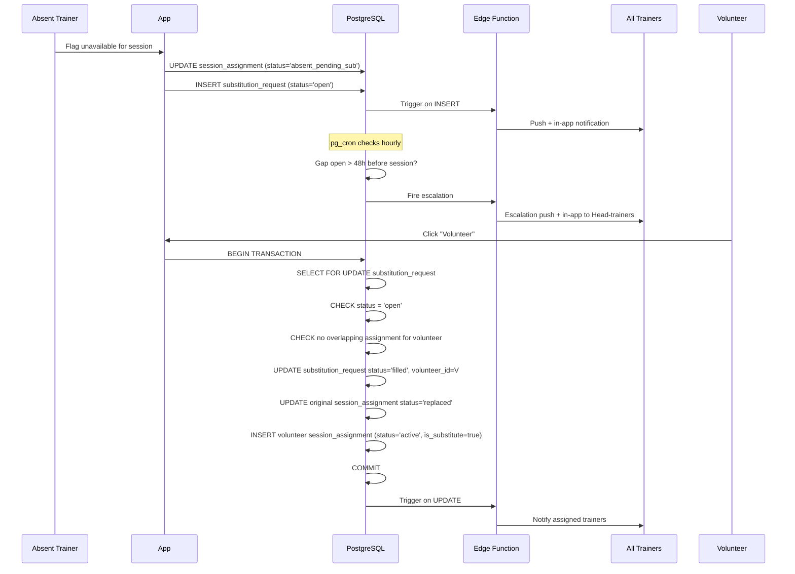

# Substitution Flow

**Summary**: Describes the race-condition-safe substitution workflow for PocketCoach, including the flag-unavailable trigger, volunteer confirmation via database transactions, the 48-hour escalation cron, and double-booking prevention.

**Sources**: None

**Last updated**: 2026-10-11

---

## Table of Contents
- [Overview](#overview)
- [Sequence Diagram](#sequence-diagram)
- [Race-Condition Safety](#race-condition-safety)
- [Escalation Cron](#escalation-cron)

---

## Overview

The substitution system ensures the originally assigned number of trainers per session is maintained. When an assigned trainer cannot attend, the system broadcasts a request and any eligible trainer can volunteer. The volunteer is immediately confirmed — no Head-trainer approval is required.

This replaces the current WhatsApp-based substitution workflow described in [[requirements/sessions-and-assignment]].

---

## Sequence Diagram

---

## Race-Condition Safety

When multiple trainers click "Volunteer" simultaneously, the system prevents double-booking using a PostgreSQL transaction with row-level locking (mitigation for Risk 3 in [[codebase/risk-analysis]]):

1. **`BEGIN TRANSACTION`** — starts an atomic unit of work.
2. **`SELECT FOR UPDATE`** on `substitution_requests` — locks the row, forcing concurrent volunteers to wait.
3. **Status check** — verifies `status = 'open'`. If already `'filled'`, the transaction aborts.
4. **Overlap check** — verifies the volunteer has no existing `session_assignments` during the same time slot.
5. **Write** — updates the request to `'filled'`, sets `volunteer_id`, updates the original trainer's assignment status to `'replaced'`, and inserts the volunteer's new assignment marked `status = 'active'`, `is_substitute = true`.
6. **`COMMIT`** — releases the lock. Any queued concurrent transaction now sees the updated status and aborts cleanly.

---

## Escalation Cron

A `pg_cron` job runs hourly, checking for substitution requests where:
- `status = 'open'`
- The session date is within 48 hours

When triggered, the cron fires a Supabase Edge Function that broadcasts an escalation notification to all Head-trainers and Super-admins for manual follow-up. This is monitored for failures as described in Risk 6 of [[codebase/risk-analysis]].

## Design Update (2026-10-11): Coverage-based Gaps

Decided together with the Modernist design ([[codebase/implementation-plan#decisions-of-2026-10-11]]). Where this section differs from the diagram and text above, this section applies.

- **A gap is a coverage shortfall**, not only an unfilled request: a published, upcoming session whose active assignments on a track are fewer than the session's required number (`required_regular`, `required_junior`). Sessions that were never fully staffed therefore show up as gaps too. A substitution request still records who is out and drives the "can't make it" notifications.
- **Published only**: trainers see and can volunteer for published sessions only; draft sessions are invisible to them.
- **Flagging** sets the trainer's assignment to `absent_pending_sub` (the row is kept for history) and creates a request. The trainer no longer counts toward coverage.
- **Locking**: volunteering locks the **session row** with `SELECT FOR UPDATE` instead of the request row, so the coverage check and the insert are atomic for request-backed and never-staffed gaps alike.
- **Eligibility**: the trainer's track matches the gap (14/18 label means the junior track); they are not already on the session; they have no overlapping session on the same day, in any hall; the session is upcoming. A rule that blocks dates the trainer marked unavailable arrives with availability surveys (Phase 2.1).
- **Escalation**: gaps starting within 48 hours that have not been escalated notify Head-trainers and Super-admins once per session and track.
- **Counting**: `replaced` and `absent_pending_sub` assignments never count as completed sessions; the substitute's assignment (`is_substitute = true`) does. See the `session_log` view in [[codebase/implementation-plan#sub-phase-15-substitutions-coverage-gaps--session-log]].

## Authorization Requirements

Set in Sub-Phase 1.4b so the workflow in 1.5 builds on enforced rules (see [[codebase/architecture/database-schema#row-level-security]]):

- Any authenticated trainer can read substitution requests (open gaps are visible to everyone).
- A trainer can create a request only for themselves, as `open`, without a volunteer. Clients cannot set `volunteer_id` or `status = 'filled'` directly; Head-trainer+ may update or delete requests.
- Volunteering and escalation therefore run in server-side functions. Because `SECURITY DEFINER` functions bypass RLS, the volunteer function must itself verify the caller with `auth.uid()` and have `EXECUTE` revoked from `anon` and `PUBLIC` (risk 8 in [[codebase/risk-analysis]]).
- The eligibility rules for the function are decided above; remaining details to confirm (undo, escalation record) are listed in [[codebase/implementation-plan#details-to-confirm]].

## Related pages

- [[codebase/known-issues]]
- [[codebase/architecture/system-architecture]]
- [[codebase/architecture/notification-system]]
- [[codebase/architecture/database-schema]]
- [[codebase/risk-analysis]]
- [[requirements/sessions-and-assignment]]
