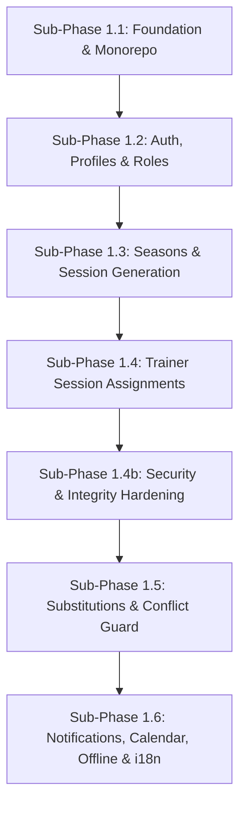

# Implementation Plan (Phase 1)

**Summary**: Sequential, testable implementation plan for PocketCoach Phase 1 (Sessions & Trainer Management), covering sub-phases 1.1 through 1.6 plus the 1.4b security and integrity hardening pass, with explicit component changes, database migrations, and testable milestones for each phase. Sub-Phases 1.1–1.4 are implemented. Availability Surveys & Matrix Dashboard are deferred to Phase 2.

**Sources**: None

**Last updated**: 2026-10-11

---

## Table of Contents
- [Overview & Workflow](#overview--workflow)
- [Sub-Phase 1.1: Project Setup & Monorepo Foundation](#sub-phase-11-project-setup--monorepo-foundation)
- [Sub-Phase 1.2: Authentication, User Profiles & Role Management](#sub-phase-12-authentication-user-profiles--role-management)
- [Sub-Phase 1.3: Seasons, Training Days, Hall Locations & Automatic Session Generation](#sub-phase-13-seasons-training-days-hall-locations--automatic-session-generation)
- [Sub-Phase 1.4: Trainer Session Assignments & Personal View](#sub-phase-14-trainer-session-assignments--personal-view)
- [Sub-Phase 1.4b: Security & Integrity Hardening](#sub-phase-14b-security--integrity-hardening)
- [Sub-Phase 1.5: Smart Substitutions & Race-Condition Guard](#sub-phase-15-smart-substitutions--race-condition-guard)
- [Sub-Phase 1.6: Notifications, Calendar Sync, Offline & i18n Polish](#sub-phase-16-notifications-calendar-sync-offline--i18n-polish)
- [Phase 2: Availability Surveys & Matrix Dashboard](#phase-2-availability-surveys--matrix-dashboard)
- [Verification & Acceptance Summary](#verification--acceptance-summary)

---

## Overview & Workflow

The Phase 1 implementation is broken down into **6 incremental sub-phases**, plus a **1.4b hardening pass** inserted after the review of 1.4. Each sub-phase produces a fully compiled, testable version of the application before proceeding to the next. Open problems are tracked in [[codebase/known-issues]].

---

### Sub-Phase 1.1: Project Setup & Monorepo Foundation

**Goal**: Establish the Turborepo monorepo, design tokens, UI layout primitives, and local Supabase development environment with automated test seed data.

#### Proposed Changes

##### Root & Monorepo Config
- `package.json`, `pnpm-workspace.yaml`, `turbo.json`

##### `packages/shared-types`
- TypeScript definitions for database models, roles, and API DTOs

##### `packages/supabase`
- Supabase CLI configuration, local migration scripts
- `seed.sql`: Pre-populated test accounts (`admin@club.de`, `headtrainer@club.de`, `trainer1@club.de`, `junior1@club.de`) for instant testing after each sub-phase

##### `apps/web` (React 19 + Vite)
- Design token CSS variables (`src/styles/tokens.css`, `src/styles/global.css`)
- Layout components: `Shell`, `Header`, `Sidebar`, `BottomNav`
- Router setup (`React Router v7`) with placeholder routes
- UI primitives: `Button`, `Card`, `Modal`, `Badge`, `Spinner`, `Toast`

#### Testable Milestone 1.1
- [x] Run `pnpm dev` → launches app shell with responsive sidebar (desktop) and bottom nav (mobile).
- [x] Run `supabase start` → local Postgres DB starts with pre-populated test accounts in `seed.sql`.
- [x] Run `pnpm build` → clean compilation across all monorepo workspaces.

---

### Sub-Phase 1.2: Authentication, User Profiles & Role Management

**Goal**: Implement email/password login, Google OAuth, Super-admin user invitation flow, profile management, and role-based permissions (Trainer, Head-trainer, Super-admin).

#### Proposed Changes

##### Database Migrations (`packages/supabase/migrations/`)
- `20260818000000_initial_schema.sql`: Creates all 14 base tables, including `profiles` (`id`, `display_name`, `email`, `avatar_url`, `specialty`, `is_junior_coach`, `is_active`, `preferred_language`, `calendar_token`) and `user_roles` (`id`, `profile_id`, `role`, `granted_at`, `granted_by`), as well as the tables used by later phases (`session_assignments`, `substitution_requests`, `notifications`, `device_tokens`, `availability_*`), initially with open development policies. Later sub-phases tighten these rather than creating new tables.
- `20260913000000_tighten_auth_rls.sql`: Strict Row-Level Security (RLS) policies for `profiles` and `user_roles` using `is_super_admin` `SECURITY DEFINER` helper function

##### Web Application (`apps/web/src/features/`)
- `features/auth/`: `LoginForm`, `InviteModal`, `GoogleOAuthButton`; registration and invite-completion pages (`LoginPage`, `RegisterPage`, `InvitePage`) live in `pages/Auth.tsx`
- `features/trainers/`: `TrainerRoster`, `TrainerProfileEditor`, `RoleManagerModal`
- `lib/supabase.ts`: Supabase client setup with auth session listener
- `hooks/useAuth.tsx`, `hooks/usePermissions.ts`: Permission evaluation hooks

#### Google OAuth Note
- **Local Dev vs Production Configuration**: `GoogleOAuthButton` triggers `supabase.auth.signInWithOAuth({ provider: 'google' })`. To enable live external Google Sign-In redirects locally, Google OAuth Client ID and Secret must be added to `packages/supabase/config.toml` under `[auth.external.google]`. Unit tests (`GoogleOAuthButton.test.tsx`) mock and verify provider parameter dispatch cleanly.

#### Additional Implemented Features in Phase 1.2
- **Live Calendar Feed Sync (WebCal)**: Integrated WebCal subscription feed URL display and 1-click token regeneration ("Regenerate Link") in `TrainerProfileEditor.tsx` (`/settings`).
- **Dashboard Management Shell (`/dashboard`)**: Operational status hero banner, active user metrics, system health indicator, and route shortcuts.
- **Preview Page Shells**: Page structures for Training Sessions (`/sessions`), Availability Survey Matrix (`/availability`), and Substitution Gaps (`/substitutions`).
- **Glassmorphism Design System & Theme Engine**: CSS token variables (`tokens.css`, `global.css`), dark/light mode toggle (`useTheme.tsx`), and UI primitives (`Button`, `Card`, `Badge`, `Modal`, `Toast`, `ThemeToggle`).
- **Developer Ergonomics**: Demo account 1-tap quick fill buttons (`LoginForm.tsx`), base64 setup link generator (`InviteModal.tsx`), and root helper script `pnpm supabase:reset`.
- **Testing Infrastructure** (as of the 1.4b hardening pass): 76-test Vitest suite across 14 files (`apps/web/src/test/`), 10-test Playwright E2E suite across 7 files (`apps/web/e2e/`), and 77 pgTAP database permission checks across 2 files (`packages/supabase/tests/`, run with `pnpm test:db`; CI runs them before the Playwright suite).

#### Testable Milestone 1.2
- [x] Super-admin logs in and invites a new trainer via email (`/trainers`).
- [x] Inbucket local email dashboard (`http://localhost:54324`) captures the invitation link.
- [x] Invited trainer opens invitation link (`/invite/:token`), completes registration, and gets the base **Trainer** role automatically.
- [x] Trainer edits display name, avatar, and free-text "Responsibility / Speciality" in `/settings`.
- [x] Super-admin grants **Head-trainer** role to a user; elevated permissions unlock immediately without re-login.
- [x] Trainer views personal WebCal feed link and regenerates calendar token in `/settings`. *(The feed URL does not resolve until the `calendar-feed` Edge Function ships in Sub-Phase 1.6; see [[codebase/known-issues]].)*
- [x] Postgres database enforces strict role-based RLS policies for `profiles` and `user_roles`.

---

### Sub-Phase 1.3: Seasons, Training Days, Hall Locations & Automatic Session Generation

**Goal**: Configure training seasons, sports hall locations, default season templates, and weekly training days, and automatically batch-generate session records (with hall locations and player groups attached) for the entire season date range.

#### Proposed Changes

##### Database Migrations (`packages/supabase/migrations/`)
- `20260927000000_seasons_locations_and_templates.sql`:
  - Create `locations` table (`id`, `name`, `district_area`, `is_active`) and seed default 3 halls (*Sporthalle Schulhaus Apfelbaum (Oerlikon)*, *Sporthalle Borrweg (Friesenberg)*, *Sporthalle Wolfsblick (Zürich-Affoltern)*).
  - Create `season_templates` table (`id`, `name`, `description`, `is_default`, `template_data`) and seed `Standard Junior Season` schedule template.
  - Add `location_id` foreign key to `training_days` and `sessions`.
  - Database stored procedure `generate_season_sessions(p_season_id UUID)` to auto-populate `sessions` (including date, times, location, and player groups) for all configured training day slots in the season date range. Hardened in 1.4b: Head-trainer+ only, and refuses to regenerate once sessions have assignments or overrides.

##### Web Application (`apps/web/src/features/`)
- `features/locations/`: `LocationManagerModal` (view/edit hall locations per season).
- `features/seasons/`: `SeasonSetupModal` (wizard supporting 1-click `Standard Junior Season` template application, location select per slot, and custom schedule adjustment), `TemplateSelector`, `TrainingDayRow`; seasons and individual sessions can also be deleted by Head-trainer+.
- `features/sessions/`: `SessionScheduleView` (chronological session schedule filterable by Hall Location, Day of Week, and Group), `SessionCard` (location badge & group tags), `SessionOverrideModal` (single session time/location/group override).

#### Standard Default Junior Schedule
- **Tuesday (17:30 – 19:00)**: All Groups (`Kids / Basic`, `Advanced-1`, `Advanced-2`) @ *Sporthalle Schulhaus Apfelbaum (Oerlikon)*
- **Wednesday Slot 1 (17:30 – 18:30)**: Beginner Level (`Kids / Basic`) @ *Sporthalle Borrweg (Friesenberg)*
- **Wednesday Slot 2 (18:15 – 19:45)**: Intermediate / Advanced Level (`Advanced-1`, `Advanced-2`) @ *Sporthalle Borrweg (Friesenberg)*
- **Thursday (17:30 – 19:00)**: All Groups (`Kids / Basic`, `Advanced-1`, `Advanced-2`) @ *Sporthalle Wolfsblick (Zürich-Affoltern)*
- **Friday (17:30 – 19:00)**: All Groups (`Kids / Basic`, `Advanced-1`, `Advanced-2`) @ *Sporthalle Schulhaus Apfelbaum (Oerlikon)*

#### Testable Milestone 1.3
- [x] Head-trainer creates a Season (e.g. Aug 1 – Jul 31) using the **Standard Junior Season** default template.
- [x] Form pre-fills 3 hall locations, player group levels, and 5 weekly training slots (Tue, Wed x2, Thu, Fri).
- [x] System automatically batch-generates all session records for every configured weekday slot in that date range with hall locations and player group linkages.
- [x] Head-trainer browses `/sessions`, filters by Hall Location, and sees the auto-generated schedule.
- [x] Head-trainer overrides time or location for a specific holiday/event session.

---

### Sub-Phase 1.4: Trainer Session Assignments & Personal View

**Goal**: Enable Head-trainers to assign trainers to sessions directly from session cards or via a bulk recurring assignment tool across 2 independent tracks, and provide trainers with their personal "My Sessions" schedule and statistics breakdown.

#### Proposed Changes

##### Database Migrations (`packages/supabase/migrations/`)
- `session_assignments` (`id`, `session_id`, `profile_id`, `track`, `session_role`, `status`, `is_substitute`, `assigned_at`, `assigned_by`) already exists from the initial schema.
- `20260927000001_session_assignments_rls_and_helpers.sql`: Role-based RLS for `session_assignments`, `is_head_trainer()` helper, and the `bulk_assign_trainer()` procedure.

##### Web Application (`apps/web/src/features/`)
- `features/sessions/`:
  - `SessionAssigneeModal`: Select a session card on `/sessions` to view, assign, or unassign Primary Trainer (Track 1) and Junior/Assistant Coach (Track 2).
  - `BulkAssignModal`: Select a trainer and recurring weekday/location pattern (e.g. "Assign Trainer A to all Friday sessions at Schulhaus Apfelbaum") to batch-assign in 1 click. Additive and upcoming-only after 1.4b.
  - `MySessionsList`: Chronological view of user's own upcoming assigned sessions. Regular trainers land on this view by default; Head-trainers and Super-admins land on the full schedule.
  - `PersonalStatsCard`: Breakdown by role (Trainer, Assistant-coach, 14/18 Coach, Total) showing Completed vs. Total Assigned.

#### Testable Milestone 1.4
- [x] Head-trainer assigns regular trainers and 14/18 coaches via direct session card detail modals and the Bulk Assign tool.
- [x] Assigned trainers navigate to "My Sessions" and see their schedule highlighted.
- [x] Personal session stats update dynamically on the trainer's profile page and Trainer Roster.

---

### Sub-Phase 1.4b: Security & Integrity Hardening

**Goal**: Close the authorization and data-integrity problems found when reviewing Sub-Phases 1.2–1.4 before building the substitution workflow on top of them. Status: **implemented 2026-10-11**. The rules and rationale are documented in [[codebase/architecture/database-schema]] (policies, functions, triggers, constraints, migration history), [[codebase/architecture/auth-and-onboarding]] and [[codebase/risk-analysis]] (risk 8).

#### Delivered

##### Database Migrations (`packages/supabase/migrations/`)
- `20261011000000_secure_definer_functions.sql`: Head-trainer+ check, `search_path`, and revoked `EXECUTE` from `anon`/`PUBLIC` on `generate_season_sessions` and `bulk_assign_trainer`; `assigned_by` taken from `auth.uid()`.
- `20261011000001_tighten_player_group_links_rls.sql`, `20261011000002_restrict_reads_to_authenticated.sql`: closed open and always-true policies.
- `20261011000003_remove_anon_insert_fallback.sql`: removed the anonymous insert fallback that allowed self-granting any role.
- `20261011000004_protect_profile_admin_fields.sql`, `20261011000007_restrict_profile_self_insert.sql`: Super-admin-only email, active status and 14/18 Coach label; plain self-created profiles.
- `20261011000005_assignment_integrity.sql`: unique active assignment per trainer per session; additive, upcoming-only bulk assign; regeneration guard.
- `20261011000006_tighten_substitution_notification_availability_rls.sql`: policies for `substitution_requests`, `notifications`, `availability_surveys`, `availability_responses` (and `is_survey_open()`), ahead of Sub-Phases 1.5, 1.6 and 2.1.

##### Web Application
- `InviteModal` creates the account on an isolated auth client (`createIsolatedAuthClient()`), preserving the admin's session and saving the invitee's role.
- `useAssignTrainer` updates a specific assignment by id; `usePersonalStats` ignores `replaced` assignments and uses the local date (`lib/dates.ts`).
- `RoleManagerModal` gains a 14/18 Coach toggle (Super-admin only); the Settings checkbox is read-only for everyone else.

##### Tests
- pgTAP suite (`packages/supabase/tests/`, `pnpm test:db`) added to CI; new Vitest cases; Playwright `invite-registration` and trainer default-view tests.

#### Testable Milestone 1.4b
- [x] `pnpm test:db` passes: logged-out callers, trainers, Head-trainers and Super-admins get exactly the access in the RLS matrix.
- [x] Super-admin invites a Head-trainer with the 14/18 Coach label, stays logged in, and the invitee completes `/invite/:token` with the role and label in effect.
- [x] A trainer cannot change their own email, active status or 14/18 label; a Super-admin can.
- [x] Bulk assign adds trainers to upcoming sessions only; regenerating a used season is refused.

#### Still open after 1.4b
Tracked in [[codebase/known-issues]]: invite hardening (shared temporary password, guessable link, open signup, email-confirmation trigger), per-track assignment limits, 14/18 track-versus-label check, assignee swap, atomic role save, and the missing season-creation E2E test. The per-track limits and the track check should land before or with Sub-Phase 1.5.

---

### Sub-Phase 1.5: Smart Substitutions & Race-Condition Guard

**Goal**: Implement the substitution workflow — flagging unavailability, broadcasting open gaps across a top-level home banner, dedicated gaps list, and session badges, volunteer confirmation via PostgreSQL `SELECT FOR UPDATE` transactions, and 48-hour escalation.

#### Proposed Changes

##### Database Migrations & Functions (`packages/supabase/`)
- `substitution_requests` (`id`, `session_id`, `original_trainer_id`, `volunteer_id`, `track`, `status`, `created_at`, `filled_at`, `escalated_at`) already exists from the initial schema; its RLS was set in 1.4b (trainers may open a request only for themselves; filling and escalation must go through server-side functions).
- New migration adding the `volunteer_substitution` stored function. As a `SECURITY DEFINER` function it must check the caller via `auth.uid()` and revoke `EXECUTE` from `anon` (risk 8 in [[codebase/risk-analysis]]). It uses `SELECT FOR UPDATE` to lock the request row, check no double-booking for volunteer, update original assignment status to `replaced`, mark request `filled`, and insert new volunteer assignment (`status='active'`, `is_substitute=true`).
- `pg_cron` schedule: Hourly check firing Edge Function `escalation-check` for gaps open within 48h.
- **Open design decisions** (see [[codebase/known-issues]]): double-booking definition, cross-track volunteering, volunteering for one's own gap, past sessions, the dependency of escalation notifications on 1.6, and which page hosts `HomeGapBanner`.

##### Web Application (`apps/web/src/features/`)
- `features/substitutions/`:
  - `FlagUnavailableButton`: Updates assignment status to `absent_pending_sub` and creates substitution request.
  - `HomeGapBanner`: High-visibility top-level alert banner on home screen for open gaps within the next 7 days.
  - `OpenGapsList`: Dedicated tab listing unstaffed session gaps.
  - `VolunteerButton`: Triggers transaction; displays instant confirmation or error toast if slot was filled by someone else.

#### Testable Milestone 1.5
- [ ] Trainer A flags unavailability → status becomes `absent_pending_sub`, home alert banner appears for gaps within 7 days, and entry appears in "Open Substitution Gaps".
- [ ] Trainer B clicks "Volunteer" → transaction confirms B immediately (status `replaced` for A, new `is_substitute` assignment for B).
- [ ] Simultaneous test: Two windows click "Volunteer" at the exact same millisecond → exactly one succeeds, the other gets a clear "Already filled" notification.
- [ ] 48h Gap Escalation: A gap left open < 48h before a session triggers an escalation alert for Head-trainers.

---

### Sub-Phase 1.6: Notifications, Calendar Sync, Offline & i18n Polish

**Goal**: Integrate FCM push notifications, WebCal live feed with token revocation safety, TanStack Query IndexedDB offline caching, PWA non-intrusive installation banner, and German/English localization.

#### Proposed Changes

##### Database Migrations (`packages/supabase/migrations/`)
- `device_tokens` and `notifications` already exist from the initial schema. `notifications` policies were set in 1.4b (recipients read, mark read and delete their own; no client inserts, rows are created by the `send-notification` Edge Function with the service role). `device_tokens` has RLS enabled but **no policies yet**, so clients cannot access it; add own-token policies in a new migration.

##### Supabase Edge Functions (`packages/supabase/functions/`)
- `send-notification/`: Central push + in-app dispatcher for 7 event types
- `calendar-feed/`: Returns `text/calendar` HTTP response for `/calendar-feed?token=<calendar_token>`

##### Web Application (`apps/web/src/`)
- `features/notifications/`: `NotificationBell`, `NotificationDrawer`, `usePushRegistration`
- `features/calendar/`: `CalendarExportButton` (`.ics` download), `SubscriptionLinkGenerator`, `RegenerateTokenButton` in Settings
- `i18n/`: `react-i18next` configuration with complete `public/locales/en/*.json` and `public/locales/de/*.json`
- `pwa/`: `vite-plugin-pwa` configuration, service worker registration, `<OfflineBanner>` component, IndexedDB cache persistence (`persistQueryClient`), `PWAInstallBanner` (non-intrusive dismissible prompt with iOS Safari / Android instructions)

#### Testable Milestone 1.6
- [ ] **PWA & Offline**: App shows non-intrusive "Install PocketCoach" banner. Installs to home screen. Toggling Airplane Mode keeps `/sessions` readable from IndexedDB with `<OfflineBanner>`.
- [ ] **Notifications**: Action (e.g. assigned to session) triggers in-app notification bell count and FCM push notification.
- [ ] **Calendar Sync**: Trainer downloads `.ics` file or subscribes via WebCal feed. Clicking "Regenerate Link" in Settings invalidates old feed URL instantly.
- [ ] **Localization**: Switch language toggle between English and Deutsch — 100% of UI text, badges, and system messages translate cleanly.

---

## Phase 2: Availability Surveys & Matrix Dashboard

### Sub-Phase 2.1: Availability Surveys & Matrix Dashboard

**Goal**: Implement availability survey creation, date-by-date trainer responses, and the scrollable Head-trainer Availability Matrix grid with sticky headers, month quick filters, workload summaries, and survey locking.

#### Proposed Changes

##### Database Migrations (`packages/supabase/migrations/`)
- `availability_surveys` (`id`, `season_id`, `name`, `range_start`, `range_end`, `status`) and `availability_responses` (`id`, `survey_id`, `profile_id`, `session_id`, `state`) already exist from the initial schema.
- RLS (done in 1.4b via `is_survey_open()`): trainers insert, update and delete only their own responses while the survey is `open`; Head-trainer+ see and manage all responses.

##### Web Application (`apps/web/src/features/`)
- `features/availability/`:
  - `SurveyCreateModal`: Create survey for date range (e.g. Aug–Dec).
  - `TrainerSurveyForm`: Mobile-friendly list where trainers tap ✅ Available, ❌ Unavailable, 🔶 Tentative per session.
  - `AvailabilityGrid`: Scrollable matrix with sticky date column (left) and trainer header (top), plus a Month Quick Filter tab bar (e.g. All, Aug, Sep, Oct).
  - `TrainerTypeFilter`: Toggle matrix between Regular Trainers and 14/18 Coaches.
  - `WorkloadSummaryRow`: Dual summary metrics (Completed Sessions vs. Total Assigned).
- `features/dashboard/`: `AdminDashboard` shell integrating the matrix and quick stats.

---

## Verification & Acceptance Summary

| Sub-Phase | Core Capability | Verification Command / Method |
|---|---|---|
| **1.1 Foundation** | Monorepo build & test seed | `pnpm build && pnpm dev` + seed test logins |
| **1.2 Auth & Roles** | Invite flow, OAuth, role grant | Inbucket (`http://localhost:54324`) → Register → Login → Elevate Role |
| **1.3 Sessions** | Season setup, auto session gen | Create Season → Verify DB `sessions` generated for weekdays |
| **1.4 Assignments** | 2-track assignment, trainer stats | Card detail modal & Bulk Assign → Verify My Sessions & Stats |
| **1.4b Hardening** | RLS matrix, function authorization, invite flow | `pnpm test:db` + Playwright `invite-registration` |
| **1.5 Substitutions** | Flag absent, volunteer, atomic lock | Home gap banner → Concurrent volunteer test → Verify RLS & transaction |
| **1.6 Polish** | PWA, offline, push, calendar, i18n | PWA banner → Airplane mode → WebCal feed & reset → Language toggle |
| **2.1 Availability** | Survey lifecycle, real-time matrix | Open survey → Sticky grid + month filter → Live updates → Close survey |

## Related pages

- [[codebase/architecture/system-architecture]]
- [[codebase/architecture/database-schema]]
- [[codebase/architecture/auth-and-onboarding]]
- [[codebase/architecture/notification-system]]
- [[codebase/architecture/offline-and-pwa]]
- [[codebase/architecture/substitution-flow]]
- [[codebase/known-issues]]
- [[codebase/risk-analysis]]
