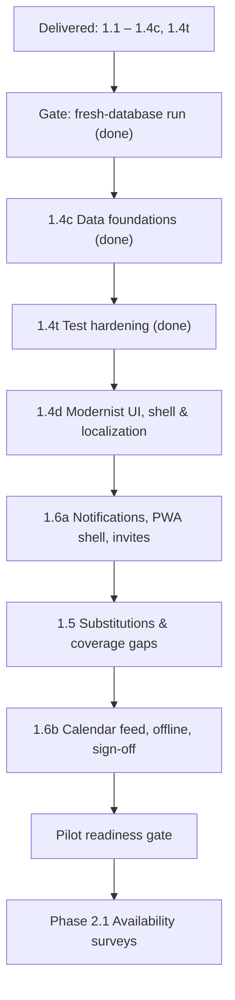

# Implementation Plan (Phase 1)

**Summary**: Streamlined, testable implementation plan for PocketCoach Phase 1 (Sessions & Trainer Management). Sub-Phases 1.1–1.4c and 1.4t are delivered and summarized; the remaining work is reordered around the Modernist UI design and five product decisions taken on 2026-10-11 (no survey yet, coverage-based gaps, published assignments, session log for later payouts, light mode only). Availability Surveys & Matrix Dashboard stay in Phase 2.

**Sources**: `pocke-coach-design-prototype/PocketCoach.dc.html` (design prototype, read 2026-10-11)

**Last updated**: 2026-10-11

---

## Table of Contents
- [Overview & Execution Order](#overview--execution-order)
- [Decisions of 2026-10-11](#decisions-of-2026-10-11)
- [Delivered: Sub-Phases 1.1–1.4c and 1.4t](#delivered-sub-phases-1114c-and-14t)
- [Design Reference](#design-reference)
- [Sub-Phase 1.4c: Data Foundations](#sub-phase-14c-data-foundations)
- [Sub-Phase 1.4t: Test Hardening](#sub-phase-14t-test-hardening)
- [Sub-Phase 1.4d: Modernist UI, App Shell & Localization](#sub-phase-14d-modernist-ui-app-shell--localization)
- [Sub-Phase 1.6a: Notifications, PWA Shell & Server-side Invites](#sub-phase-16a-notifications-pwa-shell--server-side-invites)
- [Sub-Phase 1.5: Substitutions, Coverage Gaps & Session Log](#sub-phase-15-substitutions-coverage-gaps--session-log)
- [Sub-Phase 1.6b: Calendar Feed, Offline & Sign-off](#sub-phase-16b-calendar-feed-offline--sign-off)
- [Pilot Readiness Gate](#pilot-readiness-gate)
- [Phase 2 and Later](#phase-2-and-later)
- [Where Known Issues Are Scheduled](#where-known-issues-are-scheduled)
- [Details to Confirm](#details-to-confirm)
- [Verification & Acceptance Summary](#verification--acceptance-summary)

---

## Overview & Execution Order

Each sub-phase ends in a compiled, tested application. Sub-Phase numbers 1.5 and 1.6 are kept because other wiki pages refer to them; 1.6 is split in two so notifications can precede substitutions. Sizes are rough and relative (S, M, L), not time.

| Step | Sub-phase | Delivers | Size |
|---|---|---|---|
| 0 | **Gate** ✅ done 2026-10-11 | `pnpm supabase:reset && pnpm test:db` from an empty database; local CI checks green | S |
| 1 | **1.4c** Data foundations ✅ done 2026-10-11 | Staffing targets, publishing, hall details, per-track limits, atomic save functions | M |
| 2 | **1.4t** Test hardening ✅ done 2026-10-11 | Write-policy and generated-session tests, real end-to-end assignment and role flows, unit tests for central hooks, atomic `create_season`, resilient end-to-end setup | M |
| 3 | **1.4d** Modernist UI, shell & localization | New look, navigation, all existing screens restyled, EN/DE, light mode only | L |
| 4 | **1.6a** Notifications, PWA shell, invites | Notification bell and push, install banner, server-side invites, invite-only access | M–L |
| 5 | **1.5** Substitutions & coverage gaps | Gaps, flag, volunteer, 48 h escalation, session log | L |
| 6 | **1.6b** Calendar feed, offline, sign-off | Working calendar link, offline reads, final localization checks | M |
| — | **Pilot readiness gate** | Checklist before real users | — |
| 7 | **Phase 2.1** Availability surveys | After the pilot | L |

**Why this order**
- Restyling and localization come before new screens so 1.5, 1.6 and 2.1 are built once, in the new look and in two languages.
- Staffing targets and publishing are data the redesigned Sessions screens display, so they precede the UI.
- Test hardening precedes the UI rebuild: 1.4d changes almost every component, and the review found no end-to-end test that performs an assignment and no database test for write permissions on the core tables. Behavior-level tests written first show whether the restyle broke anything.
- Notifications precede substitutions: the substitution flow is a notification flow ([[requirements/sessions-and-assignment]]), and the 48 h escalation needs the dispatcher.
- Server-side invites share the Edge Function setup with notifications, so they ride along in 1.6a.

---

## Decisions of 2026-10-11

| # | Decision | Effect on the plan |
|---|---|---|
| 1 | **No availability survey yet.** The December survey is not a target. | Phase 2.1 stays in Phase 2, after the pilot. The design's Availability screens, survey KPI tile and "survey due" card are left out of Phase 1. |
| 2 | **Gaps follow the design:** a gap is a published upcoming session with fewer assigned trainers than required on a track. | Needs staffing targets (1.4c). A substitution request adds "who can't make it" but is no longer the definition of a gap. |
| 3 | **Assignments are published.** Trainers see only published sessions. | `sessions.published_at`, a publish action, and trainer-side read rules (1.4c). Notifications go out on publish. |
| 4 | **Session log and counts matter for later pay-outs.** "Report a mistake" is not needed now. | One shared definition of "completed" (`session_log` view, 1.5); read-only log in the profile. CSV export, audit trail and mistake reporting are deferred ([Phase 2 and Later](#phase-2-and-later)). |
| 5 | **Light mode only for now.** | Remove the theme toggle and dark styles in 1.4d. |
| 6 | **Staffing targets:** 1 14/18 coach on every slot; 2 regular trainers on Wednesday (both slots), 3 on Tuesday, Thursday and Friday. | Seeded into the template and existing slots in 1.4c. |
| 7 | **A 14/18 label change is blocked** while the person has upcoming active assignments on the other track. | Enforced in `set_user_roles` (1.4c). |
| 8 | **Unpublish is included.** | `unpublish_sessions` in 1.4c, limited to sessions that have not started and have no substitution activity. |

---

## Delivered: Sub-Phases 1.1–1.4c and 1.4t

Schema, policies, functions and migration names are documented in [[codebase/architecture/database-schema]]; the invite flow in [[codebase/architecture/auth-and-onboarding]].

| Sub-phase | What exists |
|---|---|
| **1.1 Foundation** | Turborepo monorepo (`apps/web`, `packages/shared-types`, `packages/supabase`), local Supabase with seed accounts (`admin@club.de`, `headtrainer@club.de`, `trainer1@club.de`, `junior1@club.de`, password `Password123!` for development), responsive shell (sidebar and bottom nav), router, UI primitives. |
| **1.2 Auth & roles** | Email/password and Google sign-in (client ID and secret go in `packages/supabase/config.toml` under `[auth.external.google]`), Super-admin invites, base Trainer role, profile editing, role manager, role-based RLS. The calendar link and "Regenerate link" are present but the feed itself ships in 1.6b. |
| **1.3 Seasons & sessions** | Halls, season templates (*Standard Junior Season*), season wizard, automatic session generation with hall and player groups, schedule view with filters, per-session override, season and session deletion. The default weekly slots are listed in [[requirements/sessions-and-assignment]]. |
| **1.4 Assignments** | Per-session assignee modal (regular and 14/18 tracks), bulk assign, My Sessions list, trainers default to My Sessions. A personal-stats hook and card exist but are **not shown on any screen** (found in 1.4t; wired in 1.4d). |
| **1.4b Hardening** | Authorization checks on all database functions, closed open policies, no anonymous role grants, profile-field protection, unique active assignment, additive upcoming-only bulk assign, regeneration guard, isolated-client invites, pgTAP permission suite in CI. |
| **1.4c Data foundations** | Staffing targets per slot (Tue, Thu, Fri 3 + 1; Wednesday 2 + 1), hard limits of 3 regular and 2 14/18 per session, 14/18 track tied to the label, blocked label changes, atomic `set_session_assignments` and `set_user_roles`, publishing with `publish_sessions` / `unpublish_sessions` and a Publish dialog, Draft badge, hall address and note, translatable error codes. Details: [[codebase/architecture/database-schema]]. |

| **1.4t Test hardening** | Write-policy and generated-session database tests, atomic `create_season`, real end-to-end flows (assignment with limits and bulk assign, roles and label, hall details, publishing), unit tests for the central hooks and route guards, English-locale end-to-end setup, coverage summary in CI. Closed an anonymous insert path on `session_assignments` and a form race in the assignee dialog. |

Acceptance criteria for the delivered work are met, except the personal-stats display noted above. Test counts at the end of 1.4t: 127 Vitest (21 files, 67.1 % statement coverage), 13 Playwright (10 files), 222 pgTAP checks across 6 files (`pnpm test:db`, run in CI before the Playwright suite).

---

## Design Reference

The visual and navigation target is the **Modernist ledger** prototype in `pocke-coach-design-prototype/` (`PocketCoach.dc.html`, tokens in `_ds/modernist-*/styles.css`). It is a clickable prototype with mock data covering trainer, head-trainer and super-admin, desktop and mobile, English and German. It is a reference, not code to import: the design-system bundle is an empty stub and the prototype styles itself inline.

**Look**: selected segments (language switch, filters) are black, not red; Archivo throughout; flat and architectural; zero corner radius; 2 px dividers; ink (`#201e1d`) on a light ground (`#f3f2f2`) with a single red accent (`#ec3013`) used sparingly; labels flush left; Lucide icons; text links and error text on the light ground use `--color-accent-700` (6.4 : 1); ghost buttons use the plain accent as in the design (3.8 : 1, below WCAG AA for small text, accepted 2026-10-14 for consistency with the primary button).

**Colour rule** (confirmed 2026-10-14): **black means "selected"**: the selected segment of the language switch and of filters, check marks, the current navigation text, toasts. **Red (the accent) means "do something"**: the one primary button of a view (Save, Invite) and ghost buttons (New season, Regenerate link, Edit roles). Never use red for a selected state and never black for the primary action, so a view can show a filter and an action side by side without confusing state with action. Existing red state cues come from the design itself (the stripe on the current navigation item).

**Screens and what Phase 1 takes from them**

| Design screen | Phase 1 treatment |
|---|---|
| Login, invite acceptance | Yes. Invite-only copy; the public `/register` page is removed. |
| Trainer home | Yes: next session with co-trainers, upcoming list, season stats, open gaps the trainer can cover. "Survey due" card omitted. |
| Dashboard (head-trainer, super-admin) | Yes, with three tiles (current calendar week, coverage %, open gaps) instead of four; coverage-gap list, recently filled, workload bars. |
| Sessions: calendar, week chips, hall filter, "only mine", session detail with tracks and slots, override | Yes. The assignment panel lists candidates for the track sorted by fewest sessions; availability is not shown until Phase 2.1. |
| Gaps | Yes (1.5). |
| Team, profile, roles, invites | Yes. Profile gains the read-only session log (1.5). |
| Settings: profile, language, calendar, notification preferences, season slots, halls | Yes. Halls gain address and trainer note. |
| Notification drawer, install banner | Yes (1.6a). |
| **Availability** (survey, matrix, my availability) | **Phase 2.1.** Navigation item and survey tile return then. |
| "Report a mistake", CSV export | Deferred (decision 4). |

---

## Sub-Phase 1.4c: Data Foundations

**Goal**: Add the data the redesigned screens and the substitution flow depend on, and close four known issues, before any UI is rebuilt. **Status: delivered 2026-10-11** in migrations `20261012000000`–`02`; see [[codebase/architecture/database-schema]] for the rules as built.

#### Database (`packages/supabase/migrations/`)
- **Staffing targets**: `required_regular` and `required_junior` on `training_days`, copied to `sessions` at generation (overridable per session). Template data carries them. **Confirmed values (decision 6)**: Tuesday, Thursday and Friday 3 regular + 1 14/18; both Wednesday slots 2 regular + 1 14/18. Existing training days and sessions are updated to these values by weekday.
- **Per-track limits** (known issue C1): a trigger rejects more than 3 active regular trainers or 2 active 14/18 coaches on a session (the maxima from the requirements; the targets above are what counts as fully staffed). Only active assignments count, so a substitute can be added for a flagged trainer. `bulk_assign_trainer` skips sessions that are already full.
- **Track versus label** (C2): the `junior_coach` track accepts only profiles with the 14/18 label, and those profiles can only be on that track. Enforced in `bulk_assign_trainer` and by trigger. Changing a person's label is refused while they have upcoming active assignments on the other track (decision 7).
- **Publishing**: `sessions.published_at` (null means draft). `publish_sessions(season_id, from_date, to_date)` is Head-trainer+ only. Existing sessions are backfilled as published. Generated sessions start as drafts.
- **Unpublish** (decision 8): `unpublish_sessions(season_id, from_date, to_date)`, Head-trainer+ only. It returns published sessions to draft only if they have not started (Europe/Zurich) and have no substitution requests; other sessions in the range are skipped and the app reports how many. From 1.6a on, unpublishing does not recall notifications already sent.
- **Read rules**: trainers see only published rows of `sessions`, `session_player_groups`, `session_assignments` and (through the session) `substitution_requests`; Head-trainer+ see everything.
- **Halls**: `locations.address` and `locations.trainer_note`.
- **Translatable errors**: new and changed functions raise stable error codes (an SQLSTATE plus a short code) instead of English sentences, so the app can show them in the user's language (see 1.4d).
- **Atomic saves** (C3, C4): `set_session_assignments(session_id, rows)` saves all assignee rows in one transaction, so swapping two trainers works; `set_user_roles(profile_id, roles, is_junior_coach)` replaces the delete-then-insert role save and refuses to remove the caller's own Super-admin role and to change the 14/18 label as described above. Both are `SECURITY DEFINER` with the authorization pattern from [[codebase/architecture/database-schema]].

#### Web application
- Hooks and modals switch to the new functions; the assignee modal and role manager keep their current look until 1.4d.
- Head-trainer Sessions view shows a draft marker and "Publish" / "Unpublish" actions for a date range, reporting how many sessions were skipped.

#### Tests
- pgTAP: limits, track and label rules (including the blocked label change), publish and unpublish rules and visibility for trainers versus Head-trainers, atomic functions, anonymous access. Existing fixtures publish their sessions.
- Vitest and Playwright updated for the draft/published split.

#### Testable Milestone 1.4c
- [x] A fourth regular trainer, or a 14/18 coach on the regular track, is rejected.
- [x] Two trainers can swap rows in the assignee modal (database level: one atomic save; the swap is tested in pgTAP).
- [x] Draft sessions are invisible to trainers and visible to Head-trainers; publishing a week makes them visible to trainers (pgTAP and the Playwright `publishing` flow).
- [x] A Super-admin cannot remove their own Super-admin role, and cannot change a label while the person has upcoming assignments on the other track.
- [x] Unpublishing a future week hides it from trainers again; sessions that have started or have substitution requests are skipped.
- [x] Tuesday, Thursday and Friday sessions need 3 + 1, Wednesday sessions 2 + 1 (template and existing slots).
- [x] `pnpm test:db` passes from an empty database (2026-10-11: `pnpm supabase:reset` applied all 16 migrations and the seed; 138 pgTAP checks and 11 Playwright tests passed).

---

## Sub-Phase 1.4t: Test Hardening

**Goal**: Close the coverage gaps found in the review of 2026-10-11 before 1.4d rebuilds the UI, so the restyle is protected by tests that check behavior, not appearance. **Status: delivered 2026-10-11** (migrations `20261012000003` and `04`). Results and the three findings made while implementing it are under [Outcome](#outcome-of-14t).

#### Baseline (after 1.4c)

| Suite | Size | Notes |
|---|---|---|
| Unit (Vitest) | 88 tests, 16 files | 50.2 % statements, 46.0 % branches, 44.1 % functions. 0 % on `useSeasons`, `useSessions`, `useAuth`, `useLocations`, `useTrainers`, `ProtectedRoute`, `SessionScheduleView`, the auth pages, the Dashboard and the layout components. |
| End-to-end (Playwright) | 11 tests, 8 files | Covers login, sign-out, invite and invite registration, publishing, trainer default view, calendar token. |
| Database (pgTAP) | 138 checks, 4 files | Strong on functions, triggers, read rules and the tables added in 1.4b and 1.4c. |

#### Findings (see [[codebase/known-issues]])
1. **Write permissions on core tables are untested.** Adding permissive write policies on `seasons`, `training_days`, `locations`, `player_groups`, `season_templates`, `sessions` and `session_assignments` left all 138 database checks green, so nothing would notice a trainer being able to change them. Generated-session content (targets, weekdays, halls, groups) is untested too.
2. **No end-to-end test performs an assignment.** The assignments test only opens dialogs, and its assign step sits behind `if (isVisible)`; on the empty database CI starts with there are no sessions, so the step never runs.
3. **The roles end-to-end test only opens and closes the dialog**; no role or label change is saved or checked.
4. **Central hooks and pages have no unit tests** (list above).
5. **`createSeason` has no rollback.** It writes the season, groups, training days and links from the browser one by one and has already deactivated other seasons first, so a failure partway leaves a half-built season.
6. **Parallel CI risk (not observed):** CI runs end-to-end tests with 2 workers, and the publishing test creates and deletes a season that other tests may read.

#### Work

##### Database
- `write_policies.test.sql`: for each of the seven tables, a trainer and an anonymous caller are denied insert, update and delete (updates and deletes assert the row is unchanged), and a Head-trainer is allowed; also Super-admin-only profile deletes. Confirm the new tests fail when permissive policies are added (the same mutation check that exposed the gap).
- `generate_season_sessions` output test: sessions fall on the right weekdays and dates, copy hall, times, player groups and staffing targets (Tuesday 3 + 1, Wednesday 2 + 1), start as drafts, and the count is correct.
- **`create_season` function** (new migration, Head-trainer+): creates the season, player groups, training days (hall, staffing targets), group links and the generated sessions in one transaction, and deactivates other seasons only on success. Errors use the stable codes (`invalid_range`, `invalid_input`). pgTAP covers the happy path and a failure partway (for example a staffing target above the limit): nothing is created and the previously active season stays active. The web app's `createSeason` becomes a single call.

##### End-to-end
- A shared helper creates and cleans up a throwaway season (not active, one week) so tests never depend on existing data or leave any behind; the publishing test uses it too.
- **Assignment flow**: the Head-trainer assigns two trainers, one of them a 14/18 coach, through the session dialog; the trainer sees the session in My Sessions and the personal stats update; a fourth regular trainer is refused with the readable message. Bulk assign adds a trainer to a weekday without replacing others. The `if (isVisible)` guards are replaced by real preconditions.
- **Roles flow**: a Super-admin grants Head-trainer, reloads and sees it persist; a label change is blocked with the readable message while the person has upcoming assignments and succeeds when they have none. This replaces the misleading "manage and update" test.
- Hall details: edit an address and note and see them saved.

##### Unit
- `useSeasons` (single `create_season` call, error mapping, delete, generate), `useSessions` (filters, enrichment, publish, unpublish, override, delete), `useAuth` (profile and roles loading, missing profile, sign-out, auth-state changes), `ProtectedRoute` and `PublicOnlyRoute` (redirects), `useLocations`, `useTrainers`.

##### Configuration and CI
- Playwright runs with the English locale and stable test ids where role and name are ambiguous, so the German default and moved strings in 1.4d do not break selectors.
- Specs that create seasons run serially in their own project, after the parallel specs.
- Add `@vitest/coverage-v8` and print a coverage summary in CI (`pnpm test:coverage`). It does not fail the build; record the 50.2 % baseline and set thresholds only after 1.4d.

#### Deferred to 1.4d (written against the new components)
Shell and navigation by role, Dashboard, schedule view filters and "only mine", session card rendering, training-day row, auth page error cases, language toggle. `theme.spec` and `useTheme.test` are removed with light-mode-only.

#### Testable Milestone 1.4t
- [x] Adding permissive write policies to any of the seven tables makes `pnpm test:db` fail (34 checks fail; none did before).
- [x] `create_season` rolls back completely on failure (pgTAP: nothing created, the previously active season stays active); the web app uses it.
- [x] A real assignment, a bulk assignment and a role and label change each have an end-to-end test that fails if the step is skipped (verified by disabling the limit rule and the label guard: both flows fail).
- [x] Unit coverage of the listed hooks and route guards is above 80 % statements (`useSeasons` 91.9 %, `useSessions` 91.7 %, `useAuth` 97.9 %, `useLocations` 87.5 %, `useTrainers` 100 %, `ProtectedRoute` 100 %); overall unit coverage is 67.1 % and is reported in CI.
- [x] End-to-end tests run in English locale and Zurich time; season-creating specs run in their own project after the parallel ones; the suite passes with 2 workers, also on an empty database.

#### Outcome of 1.4t
- **Security fix found by the new tests**: the insert policy on `session_assignments` still contained `OR auth.role() = 'anon'` (from Sub-Phase 1.4), so anyone holding the public anon key could add trainers to sessions without logging in. The same fallback had been removed from `profiles` and `user_roles` in 1.4b but this table was missed because no test wrote to it as a logged-out or regular user. Closed in `20261012000003`; a scan of all policies found no other explicit anonymous path.
- **Bug found by the real assignment flow**: the assignee dialog showed its form, editable, for one render before it started loading the session's assignments; when the data arrived the form reset and discarded what the user had already chosen. `useSessionAssignments` now reports `loading` from the first render for a new session (unit test added).
- **Gap found**: `PersonalStatsCard` and `usePersonalStats` have been unused since 1.4: no screen shows personal stats, although the 1.4 milestone was ticked. Scheduled in 1.4d (trainer home and profile) together with an end-to-end assertion.
- Also: `create_season` replaces the browser-side sequence of writes; test ids and accessible names were added to session cards, roster cards and the assignee and bulk-assign selects.

---

## Sub-Phase 1.4d: Modernist UI, App Shell & Localization

**Goal**: Make the frontend look and navigate like the design, in English and German, light mode only, with the existing screens fully migrated. Every later sub-phase builds on this foundation.

#### Foundation
- **Tokens**: replace `tokens.css` and `global.css` with the Modernist tokens, exposed to Tailwind 4 through `@theme`. Radius 0, 2 px dividers, `:focus-visible` accent ring, disabled at 45 % opacity.
- **Light only** (decision 5): remove `ThemeToggle`, `useTheme`, all `dark:` styles and the theme tests; set `color-scheme: light`.
- **Fonts**: self-host Archivo (no Google Fonts requests). This also removes the current Google Fonts links from `index.html`, which the GDPR plan does not cover ([[codebase/data-privacy-gdpr]]).
- **Primitives**: `Button` (primary, secondary, ghost, icon; label flush left), `Tag`, `Card`, segmented control, field and input, `Dialog`, `Toast` with optional Undo, `Spinner`.

#### App shell and navigation
- Desktop: 224 px sidebar; mobile: status area and bottom tab bar. Page header with title, subtitle (for example "Season 2026/27 · CW 41"), notification bell and account menu.
- Phase 1 navigation: Home, called "Dashboard" for every role (decision 2026-10-28; the trainer's view was "My sessions" before), Sessions, Gaps, Team, Settings. Availability is absent until Phase 2.1.
- **Status 2026-10-14: shell and Settings built.** Sidebar (224 px) with name, role summary and EN | DE switch; page header with subtitle (season and calendar week on Home, "CW" in English and "KW" in German, dates in Europe/Zurich); mobile tab bar with four tabs and an account button in the header that opens Settings. Routes keep their paths (`/dashboard`, `/sessions`, `/substitutions`, `/trainers`, `/settings`). The header has an **Inbox** button (as in the design) that opens the notification drawer, and a **Sign out** button next to it. Sign-out in the header is a deliberate deviation from the design, which has it only in Settings; Settings keeps its own Sign out button as well (decision 2026-10-14). Until 1.6a the drawer shows an empty state and the unread badge is not rendered.

#### Screens migrated
- **Auth**: login with invite-only wording, language switch (Google sign-in left out for now, see below); invite acceptance; `/register` removed from the UI. Details:
  - Layout follows the design: a shared `AuthLayout` (wordmark, EN | DE switch, content, GDPR footer) with a split screen on desktop (form left, three numbered benefit rows right) and a single column on mobile. Used by login and invite acceptance.
  - Login: flat labelled fields, primary "Sign in →", left-aligned, 44 px high. Submit logic is unchanged. Errors appear in an inline `role="alert"` block.
  - **Demo-account quick-fill buttons and the Dashboard's "Test Credentials" card (seed emails and shared password) are shown in development builds only** (`import.meta.env.DEV`). CI builds the app and fails if the bundle contains them (`pnpm check:bundle`). The invite flow's temporary password (known issue S1) is still in the bundle until server-side invites ship in 1.6a; the check then also covers the password.
  - **"Forgot password?" is left out** until a reset flow exists (known issue F3, 1.6a).
  - Invite acceptance follows the design's three fields (email read-only, your name, choose a password); the confirm-password field is dropped. Benefit and invite copy do not mention availability (Phase 2.1). `/register` redirects to `/login`.
  - **Google sign-in is left out of both screens for now** (decision 2026-10-14; the design shows a "Continue with Google" button). A Google sign-in creates an account without profile or role (known issue S3), so it returns after the server-side invites in 1.6a. The component was removed in this sub-phase; it is in git history (commit `057b89f`). The invitee's language choice is saved to their profile.
  - Supabase auth errors are mapped by error code to translated messages; unknown errors show the server's text.
  - The old `.auth-btn-*`, `.styled-input`, `.input-group` and `.divider-*` rules are deleted from `global.css`.
- **Home and Dashboard (built 2026-10-28, `/dashboard`)**: Head-trainers and above get the Dashboard, everyone else the trainer home (`features/home/`). The page and navigation item are called "Dashboard" for everyone; there is no greeting in the title.
  - **Trainer home**: first, when there is one, the card "Open gaps you can cover" (**read-only until 1.5**, no Volunteer button): up to three gaps of the active season on the person's own track (the 14/18 label means the junior track), on sessions they are not already working and not overlapping another of their sessions that day (any hall), with date, time, hall and how many are needed, and "+ n more". Rules in `features/home/coverable.ts`; 1.5 adds Volunteer, the "reason when disabled" and the database's final check. Then the next session (date, time, hall, groups, role tag, "Substitute" tag, "With …" the others working it), the next five after it, "Completed sessions · season" with the big count and two smaller ones (Trainer and Assistant coach; for a 14/18 coach only 14/18, no substitute count), the upcoming count and a link to the person's session log, and the calendar card linking to Settings. Counts come from `team_session_stats` (the shared definition), the sessions from the person's own published, active, not yet ended assignments.
  - **Dashboard**: three tiles (calendar week with its date range, coverage % of **all upcoming sessions** of the active season ("n/m upcoming slots filled"), open gaps in red and counted **for the next 14 days only** (today and the 13 days after it, subtitle "Next 14 days", decision 2026-10-28); the second and third open Sessions and Gaps), the next five coverage gaps of those 14 days (one row per short track with how many are missing, a "See all gaps →" link to the Gaps page when there are more; "Assign" opens Sessions until 1.5), "Recently filled" (who covered for whom and how long ago, from filled `substitution_requests`; empty until 1.5 creates them), the viewer's own next session ("Nothing assigned to you yet." when there is none, the block is always shown), and the workload list (completed + upcoming per active person, black and grey bar, a row opens the profile).
  - **Coverage and gaps** (`useCoverage`) follow the rule of 1.5: published, upcoming sessions of **the active season only** (decision 2026-10-28: gaps of old seasons are stale; when no season is active the most recent one is used, as everywhere else) whose active assignments on a track are fewer than required; sessions that have ended and drafts are left out, so a gap goes stale the moment its session is over and never counts in the tile or the list (confirmed 2026-10-28; no grace day); a trainer who is out (`absent_pending_sub`) does not count. Coverage % is filled positions over required positions. The workload and the personal counts are for the current season.
  - **Left out until later**: Volunteer on the open-gap card (the card itself is read-only), "Can't make it", the Assign action itself (1.5); "Add to calendar" (1.6b); the survey card and tile (2.1); row links to the session detail (when Sessions is migrated). The development-only "Test Credentials" card and the placeholder hero are gone (the login screen keeps the demo quick-fill buttons).
  - Removed: `PersonalStatsCard` and `usePersonalStats` (unused, older definition of "completed") and the shared `PersonalStats` type. Unit tests 225, end-to-end 44 (new: gaps a trainer can cover, trainer home with counts, 14/18 coach counts, next five gaps of the next 14 days with a session leaving the list once staffed, gaps beyond 14 days not counted, gaps of an inactive season hidden, workload, Super-admin vs trainer, phone width; the assignment-flow test now asserts the home counts).
  - **1.4d status for Home and Dashboard**: done. Still open in 1.4d: the Sessions screen (and with it the session detail and the links to it) and the final checks of the milestone below.
- **Sessions**: week chips with month calendar, hall filter, "only mine", coverage per session (for example 2/3 · 1/2, from the staffing targets), changed marker; session detail with tracks, open slots, override modal, hall address and map link; assignment panel with candidates sorted by fewest sessions; publish control for Head-trainer+.
- **Team and profile**:
  - **Team page built 2026-10-14**: filter control with counts in brackets (All (n), Trainers (n), Head trainers (n) where a Super-admin counts too, 14/18 coaches (n)), roster rows with name, role tags and (for elevated roles) the speciality; a whole row opens the person's profile; "+ Invite trainer" (Super-admin). Email addresses are not printed on the list; they are on the profile. The role dialog is a checklist (Trainer always on, Head trainer, Super-admin, 14/18 label) saved through the atomic `set_user_roles`. The invite dialog asks for the email and the extra roles only; the invitee sets their own name. Database error codes are now translated through the catalogs (`dbErrors.*`) everywhere `describeDbError` is used.
  - **Session counts (built 2026-10-14, Head-trainers and above only, as in the design)**: columns Trainer, Assist., 14/18, Completed and Upcoming for the current season, a four-tile strip (completed, upcoming, as substitute, average per trainer) and the note on what is counted. The shared definition of "completed" now exists in the database as the `session_log` view and `team_session_stats(season_id)` (migration `20261014000000`, see [[codebase/architecture/database-schema]]); 1.5 builds the read-only log screen on the same view. On a phone only the Completed column is shown and the row actions move to their own line.
  - **Profile page (built 2026-10-14, `/trainers/:id`)**: back link, initials, name (also the page title), role tags; for Head-trainers and above (anyone) and for a person themselves: the five counts for the season ("as of" today) and the read-only session log (newest first, numbered, role and substitute tags, 8 shown with "Show all"); for everyone: the next five sessions (published, not yet ended); details (speciality for elevated roles, email); for Super-admins "Edit roles" and "Deactivate account" (never for yourself, with a confirmation; a soft delete that revokes access, as before). Edit roles and Remove moved here from the roster rows. The database enforces who sees counts and log: `team_session_stats(season, profile)` and `session_log` only return a person's own rows to a trainer. This is the profile half of C7; the trainer home gets the same counts.
  - **Still to do for Team**: CSV export and "Report a mistake" (pay-out decisions, [Phase 2 and Later](#phase-2-and-later)), deep links from the profile's session rows to the session detail (when Sessions is migrated), "Pending invites" with "Resend" (1.6a), and the design's reactivate toggle (removed people stay hidden).
- **Settings** (built 2026-10-14, replaces `TrainerProfileEditor`): two columns on desktop.
  - Profile: display name, email shown as fixed text with a lock icon (not a field, no hint line), speciality (Head-trainer and above, as in the design), read-only 14/18 label (changed in Team, which uses the atomic `set_user_roles`; Settings no longer writes `is_junior_coach`). The avatar URL field is gone (the design shows initials only; the column stays).
  - Language: English | Deutsch, applies immediately and saves to `profiles.preferred_language` (no longer part of the profile form).
  - Calendar: the link, "Copy link" and "Regenerate link" as before; the feed itself and the ".ics download" arrive in 1.6b (known issue C5).
  - Season (Head-trainer and above): current season, dates, weekly slots (weekday, time, hall, player groups) and "New season", which opens the existing wizard.
  - Halls (**Head-trainer and above**; the design shows it to Super-admins only, but Head-trainers could already manage halls): name, area, address with map link, note for trainers, add and edit in one dialog. Deactivating a hall is still only possible in the old hall manager on the Sessions screen, which goes when Sessions is migrated.
  - Notifications and the install banner sections arrive in 1.6a.

#### Localization
- `react-i18next` with `locales/en` and `locales/de`, seeded from the prototype's copy (Swiss spelling, for example "schliesst"). Plurals and interpolation through i18next.
- **Per-user language toggle (EN | DE)**, as in the prototype: on the login and invite screens and in Settings. Switching applies immediately, without a reload. Before sign-in the choice is kept in the browser (initial value from the browser language, otherwise German, the column default). After sign-in `profiles.preferred_language` is the source of truth: changing the toggle saves it, so the choice follows the user across devices.
- Dates in Europe/Zurich; ISO calendar weeks shown as "CW" in English and "KW" in German.
- **Error messages**: the app maps the stable error codes from database functions (1.4c) to translated messages; existing English sentences such as "This trainer is already assigned to this session" move into the catalogs.
- User-entered text (display names, specialties, hall notes) is stored as typed and is not translated.
- A test fails the build if any key is missing in either language.

#### Tests
- Existing Vitest and Playwright suites updated to the new components (selectors by role and test id, English locale). The season-creation and assignment end-to-end tests come from 1.4t. New tests are written with the new components: shell and navigation by role, Dashboard, schedule filters, session card, auth page error cases, language toggle. Responsive smoke runs at 390 px and 1280 px.

#### Testable Milestone 1.4d
- [ ] Every existing screen renders in the Modernist style on desktop and mobile; no dark-mode controls remain.
- [ ] The language toggle works on the login screen and in Settings, applies immediately, and persists across sign-out and devices after sign-in.
- [ ] Switching English ↔ Deutsch translates all migrated screens, including error messages; the missing-key test passes.
- [ ] Trainer and Head-trainer see the navigation and home screens described in the design.
- [ ] No request leaves the app to Google Fonts.
- [x] Login and invite screens match the prototype at 390 px and 1280 px; the production build contains no demo accounts or seed credentials (the invite flow's temporary password stays until 1.6a, S1) and no "Forgot password?" button (done 2026-10-14).
- [ ] The end-to-end suites from 1.4t still pass against the new UI (selectors updated, no behavior changes).
- [x] Personal stats (trainer, assistant, 14/18, completed, upcoming) are shown on the trainer home and the profile, and the assignment end-to-end test asserts them (2026-10-28; the test asserts that the counts are shown, not their values, because its season is inactive).

---

## Sub-Phase 1.6a: Notifications, PWA Shell & Server-side Invites

**Goal**: Deliver the notification core that substitutions depend on, an installable app, and the server-side invite flow that makes access invite-only.

#### Edge Functions & database
- Edge Function setup (service role, secrets, local runtime, CI deploy).
- `send-notification`: writes `notifications` rows and sends push (FCM) according to preferences. **Language**: in-app entries store the event type and payload and are translated by the app in the viewer's current language, so toggling the language re-translates existing entries; push text is generated server-side in the recipient's `preferred_language` at send time.
- Policies for `device_tokens` (own tokens only; none exist today).
- `notification_preferences`: one row per profile with four toggles from the design (assignments, substitution requests, surveys, role changes).
- **Invites** (known issues S1–S3): `invitations` table (email, invited by, roles, 14/18 label, **language**, sent, expires, accepted) and an `invite-user` Edge Function using `auth.admin.inviteUserByEmail()`. A trigger on `auth.users` creates the profile and base role from the invitation, so registration no longer depends on receiving a session. Public signup is disabled in `config.toml`; the temporary password and the `base64(email)` link are removed. The invite form asks for the invitee's language (default: the inviter's); the trigger copies it to the new profile, and the invitation email is sent from an English or German template accordingly.

#### Events live in this sub-phase
Assigned to sessions (sent on publish, one grouped notification per publish), role changed, and "invite not yet accepted" for Super-admins. The substitution events arrive in 1.5.

#### Web application
- Bell and drawer (unread dot, mark all read, tap opens the target screen); `usePushRegistration`.
- Settings: notification preferences section; Team: pending invites with resend and expiry.
- PWA shell: `vite-plugin-pwa` manifest and service worker, dismissible install banner with iOS Safari and Android instructions. Push on iPhones generally needs the installed app, so the banner belongs here.

#### Testable Milestone 1.6a
- [ ] Publishing a week notifies each assigned trainer once; the bell count updates and a push arrives on an installed app.
- [ ] A Super-admin invites a Head-trainer; the invitee sets their own password from a single-use link; role and label are in effect; the admin stays signed in.
- [ ] A pending invite can be resent; an unaccepted invite triggers the Super-admin reminder.
- [ ] Public signup is rejected by the API; `/register` no longer exists.
- [ ] Turning off a preference stops the corresponding push.
- [ ] A German-language trainer receives a German invite email and German push text, and an English-language trainer receives English, for the same event.

---

## Sub-Phase 1.5: Substitutions, Coverage Gaps & Session Log

**Goal**: Replace the WhatsApp substitution workflow, following the design and decisions 2 and 3. Flow and rationale: [[codebase/architecture/substitution-flow]].

#### Rules
- **Gap**: a published, upcoming session whose active assignments on a track are fewer than the required number. Sessions that were never fully staffed count; a substitution request adds "who is out".
- **Flag** (`flag_unavailable`): the assignment becomes `absent_pending_sub`, a request is created, Head-trainers and the session's trainers are notified, all trainers are told about the open gap. The trainer shows as "Out · sub requested".
- **Volunteer** (`volunteer_for_session`): locks the **session row** (`SELECT FOR UPDATE`) so coverage is checked and filled atomically, for both request-backed gaps and never-staffed ones. The first volunteer is confirmed immediately. Allowed only if: published and upcoming; the trainer's track matches the gap (14/18 label means the junior track); the trainer is not already on the session; no overlapping session the same day (time overlap, any hall). The flagged assignment becomes `replaced`; the volunteer's assignment has `is_substitute = true`. The function checks the caller with `auth.uid()` and has `EXECUTE` revoked from `anon`.
- **Escalation**: an hourly `pg_cron` SQL function finds gaps that start within 48 h and have not been escalated, and notifies Head-trainers and Super-admins through the 1.6a dispatcher. Escalations are de-duplicated per session and track.
- **Undo**: the design's four-second Undo after flagging or volunteering is backed by matching cancel functions (to confirm, see [Details to Confirm](#details-to-confirm)).

#### Session log and counts (decision 4)
- `session_log` database view (**created in 1.4d**, migration `20261014000000`; 1.5 adds the screen): one row per completed assignment (trainer, date, time, hall, role, track, `is_substitute`). **Completed** means published, `status = 'active'`, and the session has ended (Europe/Zurich). `replaced` and `absent_pending_sub` rows never count. The view respects the read rules from 1.4c.
- Profile page, team roster, dashboard workload and personal stats all read this one definition. The profile shows the read-only log (latest 8, "Show all"). Stats: trainer, assistant, 14/18, completed, upcoming, as substitute.

#### Web application
- Gaps page, with a month calendar that marks days with a gap and fully staffed days (moved here from the Dashboard on 2026-10-28); Home "open gap you can cover" (the read-only card exists since 2026-10-28; 1.5 adds the Volunteer button and the reason when disabled ("You have another session at this time", "For the other track")); gap badge in the navigation; the Dashboard's gap list and "Recently filled" already exist and fill with data once requests are created and filled; Assign on a gap opens the right session; flag button on the trainer's next session.
- New notification events: substitution request posted, trainer flags unavailability, substitution confirmed, no substitute found.

#### Tests
- pgTAP: eligibility rules, role checks, escalation de-duplication, `session_log` counts.
- **Concurrency**: a script opens two database connections that volunteer for the same slot at once; exactly one succeeds and the other receives an "already filled" error. Runs in CI.
- Playwright: flag, volunteer, "already filled" message, gap disappearing.

#### Testable Milestone 1.5
- [ ] Flagging creates a gap that appears in Gaps, Home, Dashboard and the navigation badge, and notifies the right people.
- [ ] A volunteer is confirmed immediately; the original is `replaced`; both appear correctly in the session log after the date.
- [ ] Two simultaneous volunteers: exactly one succeeds.
- [ ] A gap inside 48 h triggers exactly one escalation per session and track.
- [ ] Ineligible volunteers (overlap, other track, past session) are refused with a clear message.
- [ ] Stats in profile, team and dashboard agree.

---

## Sub-Phase 1.6b: Calendar Feed, Offline & Sign-off

**Goal**: Finish the remaining 1.6 items on top of the complete feature set.

- **Calendar feed**: `calendar-feed` Edge Function reachable at a clean `webcal://…/feed/<token>.ics` address (rewrite or proxy); events for published, active assignments only, with hall address and trainer note, and event text in the trainer's `preferred_language` at request time; `.ics` download; "Regenerate link" (exists) invalidates the old URL. The Settings link is built from the real function URL (known issue C5).
- **Offline**: TanStack Query persistence in IndexedDB for published sessions, My Sessions, gaps and notifications (read-only); `OfflineBanner`; no offline writes ([[codebase/architecture/offline-and-pwa]]).
- **Sign-off**: full walkthrough in both languages (including the invite email, push text and calendar events), missing-key test green, push verified on an installed PWA.

#### Testable Milestone 1.6b
- [ ] Subscribing to the feed shows only the trainer's published assignments; a substitution moves the event to the substitute; regenerating the link breaks the old one.
- [ ] Airplane mode keeps Sessions, My Sessions and Gaps readable with the offline banner.
- [ ] 100 % of UI text translates (enforced by the missing-key test).

---

## Pilot Readiness Gate

The plan has no production checklist yet. Before real users:

- [x] Fresh-database run passes (Gate, step 0, 2026-10-11). Re-run after each new migration batch; the remote CI run on push is still to be observed.
- [ ] 1.6a done: server-side invites, public signup disabled, no temporary password.
- [ ] Fonts self-hosted; GDPR items in [[codebase/data-privacy-gdpr]] (hosting in Switzerland, as the login screen states; data-processing agreements, erasure) verified for the production project.
- [ ] Production Supabase project, Google OAuth credentials, FCM project and Edge Function secrets configured.
- [ ] Seed accounts and the `Password123!` default do not exist in production.

---

## Phase 2 and Later

#### Sub-Phase 2.1: Availability Surveys & Matrix Dashboard (after the pilot)
Database tables and policies already exist (`availability_surveys`, `availability_responses`, `is_survey_open()`); the work is UI, realtime and notification. The prototype is the design reference:
- Head-trainer survey creation by choosing a start and end calendar week, with an answer-by date; close and reopen.
- Trainer "My availability": week chips, per-date Available / Tentative / Unavailable.
- Head-trainer matrix: desktop grid (dates × trainers, sticky headers, coverage per row, week chips and month calendar), mobile per-day view; clicking a cell assigns or unassigns; candidate list by availability then fewest sessions.
- Navigation item, dashboard "survey response" tile, trainer "survey due" card, "survey sent" notification, and the volunteer rule that blocks dates the trainer marked unavailable.
- Matrix live updates need a Supabase Realtime subscription ([[codebase/risk-analysis]], risk 5).

#### Payout readiness (later)
The session log is designed so counts can later support pay-outs. Before using it that way: CSV export from `session_log`, an audit trail of changes to past assignments, locking of completed history, and a way to report mistakes. The completed-session definition from 1.5 must not change silently once pay-outs depend on it.

#### Other deferred items
Season planning with blocks and themes, session notes (Tiptap), email fallback for critical notifications (Resend). See [[codebase/architecture/system-architecture]] and [[codebase/architecture/notification-system]]. Backlog from [[codebase/known-issues]]: re-planning a season in use (F1), replacing a bulk-assigned trainer (F2), lint warnings (T3).

---

## Where Known Issues Are Scheduled

| Issue ([[codebase/known-issues]]) | Scheduled in |
|---|---|
| S1 temporary password and guessable link; S2 public signup; S3 registration with email confirmation | 1.6a |
| C1 per-track limits; C2 track versus label; C3 assignee swap; C4 atomic role save | 1.4c, done 2026-10-11 |
| C5 calendar feed link | 1.6b |
| T1 season-creation and multi-trainer E2E tests; T5 write policies untested; T6 no real assignment E2E; T7 roles E2E saves nothing; T8 central hooks without unit tests; T9 end-to-end setup (locale, parallel runs); C6 `createSeason` without rollback | 1.4t, done 2026-10-11 |
| C7 personal stats not shown on any screen | 1.4d, done 2026-10-28 |
| F3 no password reset | 1.6a (login button omitted in 1.4d) |
| T2 fresh-database run | Gate (step 0), done 2026-10-11 |
| T4 long policy names on `availability_responses` | Before 2.1 (small migration) |
| F1, F2, T3 | Backlog |

---

## Details to Confirm

Items beyond the decisions above, proposed so work can start; each should be confirmed with the club or the developer.

1. **Hard caps** *(implemented as assumed)*: 3 regular and 2 14/18 per session (the requirement maxima) are enforced as limits even though the targets are lower; confirm with the club.
2. **Label exclusivity** *(implemented as assumed)*: 14/18 coaches only on the junior track and everyone else only on the regular track (implied by decision 7); confirm.
3. **Grouped publish notification**: one notification per publish rather than one per session.
4. **Undo**: whether the four-second Undo needs dedicated cancel functions or can be dropped.
5. **Escalation record**: a small de-duplication table versus reusing `substitution_requests`.
6. **Invite expiry**: the design shows an invite expiring after about nine days; the actual period is a Supabase setting.
7. **Notification preferences**: whether switching a type off disables push only (in-app entries always kept) or both.
8. **Open gaps on Home**: the design shows open gaps on the trainer Home; confirm no separate banner is wanted.
9. **Default language** for visitors with an unsupported browser language (proposed: German).
10. **Hall notes**: the prototype's seed notes exist in both languages, but its editor saves one text; confirm whether a note should be stored once or per language.

---

## Verification & Acceptance Summary

| Sub-Phase | Core capability | Verification |
|---|---|---|
| **1.1–1.4b** | Delivered | `pnpm test`, `pnpm test:e2e`, `pnpm test:db` |
| **Gate** | Clean migrations (done 2026-10-11: 13 migrations applied, 77 pgTAP checks, 76 unit and 10 E2E tests passed) | `pnpm supabase:reset && pnpm test:db` |
| **1.4c Data** (done) | Targets, limits, publishing, atomic saves | pgTAP (`data_foundations`, `publishing`) + Playwright `publishing` flow |
| **1.4t Test hardening** (done) | Write-policy and output tests, real E2E flows, hook tests, atomic `create_season` | `pnpm test:db` (mutation check on write policies), Playwright with 2 workers, coverage summary in CI |
| **1.4d UI** | Modernist look, EN/DE, light only | Playwright at 390 and 1280 px, missing-key test, no Google Fonts requests |
| **1.6a Notifications** | Bell, push, PWA, invite-only | Publish → notification; invite → set password; signup rejected |
| **1.5 Substitutions** | Gaps, flag, volunteer, escalation, log | pgTAP + two-connection concurrency test + Playwright |
| **1.6b Calendar & offline** | Feed, offline reads | Calendar client subscription, airplane-mode check |
| **2.1 Availability** | Survey lifecycle, matrix | After the pilot |

## Related pages

- [[codebase/known-issues]]
- [[codebase/risk-analysis]]
- [[codebase/architecture/system-architecture]]
- [[codebase/architecture/database-schema]]
- [[codebase/architecture/auth-and-onboarding]]
- [[codebase/architecture/notification-system]]
- [[codebase/architecture/offline-and-pwa]]
- [[codebase/architecture/substitution-flow]]
- [[codebase/data-privacy-gdpr]]
